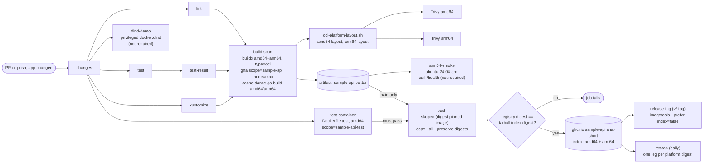

# Module 7: Docker Builds, BuildKit Caching, Containerised Tests, Docker-in-Docker and Multi-Arch Images
## Design Document

| Field | Value |
|---|---|
| **Author** | CK |
| **Date** | October 2026 |
| **Status** | Approved (2026-10-22). PR A in review (PR #15, open). PRs B and C **postponed indefinitely** (2026-10-23): Module 8 and later modules come first (§14) |
| **Affected Repo** | `kerinschristopher/Curriculum` (public), branches `mod7-caching`, `mod7-containers`, `mod7-multiarch` (§14 PR plan). New: `Acme/apps/sample-api/Dockerfile.test`; `.github/scripts/oci-platform-layout.sh`, `push-oci.sh`, `rescan-legs.sh`; `.github/scripts/tests/test_merge_gate_ruleset.py`, `test_sample_api_ci_workflow.py`, `test_dockerfile.py`, `test_trivy_workflows.py`, `test_branch_rulesets.py`, `test_oci_platform_layout.py`, `test_push_oci.py`, `test_rescan_legs.py`; `Acme/infra/github/main-protect-ruleset.json` (and a new live ruleset, X5); `docs/ci-timings.csv`. (`check-trivy-db.sh` and its test were dropped with 9c.) Changed: `.github/workflows/sample-api-ci.yml` (`changes`, `build-scan`, `push`; new jobs `test-container`, `dind-demo`, `arm64-smoke`), `.github/workflows/sample-api-rescan.yml`, `Acme/apps/sample-api/Dockerfile`, `Acme/infra/github/main-merge-gate-ruleset.json` (and the live ruleset `24832716`), `Acme/infra/github/trusted-branches-ruleset.json` (and the live ruleset `24627971`, X5), `.github/scripts/tests/test_release_tag.py`, `docs/ci.md`, `docs/iam.md` |
| **Scope** | The single maintainer (`kerinschristopher`), as author and required reviewer; everyone who opens a PR into `main` (one more required check); consumers of `ghcr.io/kerinschristopher/sample-api` (the kind cluster today, Flux from Module 8), who will get a two-platform image index instead of a single amd64 manifest. No AWS changes |

---

## Introduction / Purpose

This document designs the Module 7 deliverable from `docs/curriculum.md:334-358`:

- sample-api's CI uses the **BuildKit cache** (`docs/curriculum.md:356`).
- A new `Acme/apps/sample-api/Dockerfile.test` runs the test suite in a container, and a workflow invokes it.
- Cold-cache and warm-cache runs are timed and the numbers go in `docs/ci.md`. "The numbers are the point."
- The concepts get small, real examples: Docker-in-Docker (DinD) and the privileged-flag trade-off, rootless alternatives (explained), BuildKit cache mounts, secrets and build args, **multi-architecture images with `docker buildx`**, and CI layer-caching strategies.

It builds on Module 6's `sample-api-ci.yml` and keeps its central promise: **the bytes pushed to GHCR are the bytes that were scanned**. Going multi-arch changes how that promise is kept (an OCI image index, checked by digest), so most of the design work goes into keeping it true.

---

## Backlog Story Number / Incident Number

**Curriculum Module 7** (no tracker ID in the repo).

Related items:
- PR #9 (Module 6), PR #11 (the apply-role fix), PR #12 (the plan-artifact cleanup fix, `4d833bf`, verified by run `38631628317`) and PR #13 (sample-api 0.1.2 in all environments) are merged; `main` is at `b7f51c2`.
- `mod7` starts at `b7f51c2` (= `main`) with no Module 7 commits.
- Carry-over items C1-C8 from bgblackmore's PR #9 review are tracked in Findings.

---

## What Problem Are We Trying to Solve?

| Today, "green CI" means... | ...but it does not mean |
|---|---|
| The image builds and Trivy finds no fixable HIGH/CRITICAL issue (`sample-api-ci.yml:262-320`) | That the build is fast. `build-scan` has **no layer cache on purpose** (`sample-api-ci.yml:286`) and takes about 45 s cold *and* warm (`docs/ci.md:273`) |
| Go tests pass on the runner (`test`, `sample-api-ci.yml:146-186`) | That they pass inside a container, the way a containerised test runner would run them |
| The image is published for `linux/amd64` | That it runs on arm64 (Graviton, Apple Silicon). The Dockerfile defers that to this module (`Acme/apps/sample-api/Dockerfile:5-8`) |
| `main-merge-gate` requires 9 checks (`Acme/infra/github/main-merge-gate-ruleset.json:33-43`) | That a PR with a failing required check is **blocked**. That's still unproven (C7): only a refused direct push was tested |
| Trivy scans with a fresh DB every run (`cache: false`, `sample-api-ci.yml:311`, `sample-api-rescan.yml:88`) | That the DB download (128 MB, about 15 s, measured in M0) is a deliberate choice |

Concrete problems:
1. **The slowest step is uncached.** After Module 6's Go caches, `build-scan` is the longest step on the critical path (`docs/ci.md:276-278`).
2. **No containerised test path exists**, so the brief's `Dockerfile.test` and the DinD discussion have nothing to stand on.
3. **Multi-arch would silently weaken the scan.** Trivy, given a multi-platform OCI layout, scans only the first platform and exits 0 (F5, verified in M0). A naive multi-arch change would keep CI green while arm64 goes unscanned.

---

## Background

Short primers. Skip the ones you know.

**Images, layers and the build cache.** A Dockerfile is a list of instructions, and each `RUN`, `COPY` and `ADD` produces a *layer*. BuildKit (Docker's build engine) reuses a layer when the instruction and all of its inputs (the files it copies, the build args it uses, the layer below it) have the same checksum. The unit of reuse is the **instruction**, not a line of Go: change `main.go` and the `COPY *.go` layer changes, and so does every layer after it. `ARG VERSION` only invalidates the steps that *use* it. Here `VERSION=sha-<commit>` feeds the compile, so the compile layer is **never reused across commits** (G3).

**BuildKit features.**
- `RUN --mount=type=cache,target=…` gives a step a persistent directory (for example Go's build cache) that survives between builds **on the same builder**. It's not part of the image and isn't exported by cache backends (G2).
- `RUN --mount=type=secret` makes a secret available to one step without writing it to a layer. Secrets must never go in `ARG`: build args show up in the image history, in `mode=max` caches and in logs.
- Build args (`--build-arg VERSION=…`) are inputs, not secrets.

**Where the cache lives in CI.** A GitHub-hosted runner is a fresh VM every job, so BuildKit starts empty. A *cache backend* exports layers somewhere and imports them next time:

| Backend | Where | Fits here? |
|---|---|---|
| `type=gha` | The GitHub Actions cache service | Yes: no registry write, so the scanner job stays read-only |
| `type=registry` | An image tag in a registry | Needs `packages: write` in the scanner job |
| `inline` | Inside the pushed image | `mode=min` only (below) |

`mode=min` exports only the final image's layers. That's useless here: the final stage is `FROM scratch` with one file. `mode=max` also exports the builder stage's layers. A `type=gha` cache has a **scope** (default `buildkit`), and the last writer to a scope wins ([Docker docs](https://docs.docker.com/build/cache/backends/gha/)). GitHub's cache rules apply on top: a PR can read caches from its own ref, its base branch and the default branch, but writes only to its own ref. **Caches flow down from `main`, never up from a PR.** Unused entries are evicted after 7 days, and the least recently used ones go when the repo passes 10 GB ([changelog](https://github.blog/changelog/2025-11-20-github-actions-cache-size-can-now-exceed-10-gb-per-repository/)).

**Docker-in-Docker (DinD).** A containerised CI runner (GitLab's Docker executor, a Kubernetes pod) has no Docker daemon, so to build images it either:
- mounts the host's socket (`-v /var/run/docker.sock:…`): **root on the host**, or
- runs a second daemon in a container (`docker:dind`). That daemon needs `--privileged`: all capabilities, all devices, no seccomp or AppArmor. Its storage dies with the container, so it's **cold every time**.

Rootless builders (BuildKit rootless, Buildah, Kaniko) avoid the privileged daemon but trade away other things (see Other Designs Considered). A GitHub-hosted VM already has its own daemon and passwordless sudo, so DinD isn't *needed* here. This module demonstrates it so you can see its cost.

**Multi-arch images.**
- An **image manifest** describes one platform's image (its config and layers).
- An **image index** (a "manifest list") is a small JSON list of manifests, one per platform. Clients pick the entry that matches their CPU.
- `buildx build --platform linux/amd64,linux/arm64` builds both. There are two ways to get the arm64 binary:
  - **emulation (QEMU)**: runs arm64 instructions on amd64, slowly;
  - **cross-compilation**: the builder stays native (`FROM --platform=$BUILDPLATFORM`) and the Go compiler is told the target (`GOOS=$TARGETOS GOARCH=$TARGETARCH`). Go cross-compiles easily, so this design uses cross-compilation only.

**OCI layout and digests.**
- `type=oci` exports a tarball holding `index.json`, `oci-layout` and `blobs/sha256/<digest>`.
- Every object is named by the SHA-256 of its bytes. An index names its manifests by digest, and a manifest names its layers by digest. So **one digest at the top fixes every byte below it**, the same way a git commit ID fixes a whole tree (a Merkle tree).
- That's why "pushed = scanned" can be checked with a single comparison.

**Required checks and skipped jobs.** A job skipped by its `if:` reports **Success**, even when it's a required check ([GitHub docs](https://docs.github.com/en/pull-requests/collaborating-with-pull-requests/collaborating-on-repositories-with-code-quality-features/about-status-checks)). That's how the `changes` job keeps unrelated PRs moving (`docs/ci.md:65-70`). It also means a required job whose `needs` failed shows green. The `*-result` aggregators exist for that (`sample-api-ci.yml:190-202`).

---

## Design Goals / Requirements

### What Is It?

```
PR / push (app changed)
 ├─ lint, test (matrix) ─► test-result ─┐
 ├─ kustomize ──────────────────────────┤
 │                                      ▼
 │                build-scan  [contents: read, no secrets]
 │                  buildx --platform linux/amd64,linux/arm64
 │                  cache: type=gha,scope=sample-api,mode=max + cache-dance (Go build cache)
 │                  → sample-api.oci.tar (index) → split per platform → Trivy amd64, Trivy arm64
 │                  → upload the tarball
 │                    ├─► arm64-smoke (ubuntu-24.04-arm): run arm64 image, curl /health   [not required]
 │                    └─► push (main only) [packages: write]
 │                          skopeo (pinned image) copy --all --preserve-digests
 │                          → registry index digest == tarball index digest, or fail
 ├─ test-container  [required]  Dockerfile.test, scope=sample-api-test, amd64
 └─ dind-demo       [not required] privileged docker:dind, builds and runs Dockerfile.test, timed
```

**Functional requirements**

| ID | Requirement |
|---|---|
| FR1 | `build-scan` uses the BuildKit cache: `type=gha`, `mode=max`, `scope=sample-api`, on every run including `main` (decision 1) |
| FR2 | The Dockerfile's compile step uses a Go build-cache mount (`id=go-build-${TARGETARCH}`), persisted across CI runs with `buildkit-cache-dance` (decision 2, SD5) |
| FR3 | `Acme/apps/sample-api/Dockerfile.test` compiles the race-enabled test binary in `RUN` and runs the tests in `CMD`; the `test-container` job in `sample-api-ci.yml` builds and runs it (decisions 3, 4a) |
| FR4 | `test-container` is a required check in `main-merge-gate`; a structural test keeps every required context a real check name (decision 4b) |
| FR5 | The image is published for `linux/amd64` and `linux/arm64` under one tag (an image index), cross-compiled in the single `build-scan` job, with no emulation (decision 6) |
| FR6 | **Every platform is scanned.** A vulnerability present only in arm64 turns `build-scan` red (SD1) |
| FR7 | **Pushed = scanned, by index digest.** The `push` job fails unless the downloaded archive's index digest, and then the registry's, equal the `index_digest` that `build-scan` recorded before any third-party step ran (SD2, L9a-1) |
| FR8 | `release-tag` gives a two-platform index its semver tag without changing its digest |
| FR9 | The daily rescan scans every platform, by digest (SD3) |
| FR10 | The arm64 image is executed at least once per app change, on a native arm64 runner (SD4) |
| FR11 | A DinD demo job builds and runs `Dockerfile.test` inside a privileged `docker:dind` daemon and is timed against the runner's own Docker (decision 5) |
| FR12 | The Trivy DB cache is on in `build-scan` and `rescan`, deliberately, and measured (decision 7). **Reversed (Q9, `762a707`): `cache: false`**, after the measurement showed no gain |
| FR13 | `docs/ci.md` reports cold, warm, realistic and first-`main` times using the decision 8 method, with the raw samples in `docs/ci-timings.csv` |

**Non-functional requirements**

| ID | Requirement |
|---|---|
| NFR1 | PR feedback stays under 5 minutes (Module 6 NFR1) |
| NFR2 | Every third-party action and image is pinned by SHA or digest, including images an action starts itself (cache-dance's `utility-image`, L9a-6) |
| NFR3 | `build-scan` keeps `contents: read` only and no secrets (`sample-api-ci.yml:269-270`); only `push` and `release-tag` hold `packages: write` |
| NFR4 | TDD with the order visible; one behaviour per commit (C1); characterisation tests labelled (C6) |
| NFR5 | Every timing and every "tested" claim links a run ID and attempt, or a commit (C4) |

### If It Is an Existing Design, How Does It Work Before New Design?

Baseline: `mod7` at `4d833bf` (2026-10-16). Line numbers point at that commit; the cited files are unchanged at `b7f51c2` (only overlay and deployment YAML changed).

- **`build-scan`** (`sample-api-ci.yml:262-320`): set up buildx (`:281-282`), then `build-push-action` with `outputs: type=docker,dest=…/sample-api.tar` (`:297`), `provenance: false` (`:298`), no cache. Trivy scans the tarball with `cache: false` (`:300-311`). On `main` it uploads the tarball for one day (`:313-320`).
- **`push`** (`:322-353`): downloads it, `docker load` (`:339-340`), logs in with `GITHUB_TOKEN`, `docker push` of `sha-<short>` (`:352-353`). It never checks out code.
- **`release-tag`** (`:358-386`): sparse checkout of `.github/scripts` (`:368-372`), then `release-tag.sh`. That script copies with `imagetools create --prefer-index=false` (`release-tag.sh:28-30`) and checks both tags have the same digest (`release-tag.sh:35-41`).
- **The Dockerfile:** two stages. `golang:1.27.3-alpine` is pinned by digest (`Dockerfile:9`; 1.27.2 until PR #14 fixed CVE-2026-111943), then `ARG VERSION` (`:14`), one `RUN go build` with no cache mount (`:15`), and `FROM scratch` (`:17-21`). It's amd64 only.
- **The merge gate:** 9 required checks (`main-merge-gate-ruleset.json:33-43`), applied by hand with `gh api -X PUT` (`docs/ci.md:72-74`). Nothing tests the JSON.
- **The `changes` job** (`sample-api-ci.yml:44-89`) sets `app` (`:80`) and `scripts` (`:85`). `scripts` doesn't cover `Acme/infra/github/`, `terraform-plan.yml` or the Dockerfiles (X3).
- **The rescan** (`sample-api-rescan.yml`): pulls each picked tag by name (`:78-88`), so on an index it would scan one platform.
- **Run times:** `build-scan` 44 s cold, 48 s warm, one sample each, uncached (`docs/ci.md:273`).

### Why Do We Have It? / Why Should We Have It?

- **The feedback loop is the product.** "A test pipeline that has to rebuild the world every run is a pipeline that gets skipped" (`docs/curriculum.md:346`). Caching shortens the delay in the change → signal loop.
- **Measured, not assumed.** G3 predicts modest gains, so honest numbers matter more than big ones. A "warm" number that's really cold, or one that's flattering, teaches the wrong lesson.
- **Containerised tests** run the same way on any machine with Docker, which is the reason DinD exists.
- **Multi-arch done properly** shows that a guarantee ("pushed = scanned") has to be re-earned when the artifact's shape changes.

---

## Assumptions / Prerequisites

| # | Assumption / prerequisite | Basis |
|---|---|---|
| A1 | sample-api is one Go package | Both `main.go` and `main_test.go` declare `package main` (line 1) |
| A2 | The repo stays public, so standard and `ubuntu-24.04-arm` runners are free | F14 |
| A3 | The live ruleset PUT (Phase 11) happens after PR B merges, so `test-container` already exists on `main` and every later branch has it. Only a PR opened from an older `main` and still open could be stranded; none is expected | PR plan (§14) |
| A4 | The runner image (ubuntu-24.04) keeps Docker 28 with the classic image store and Buildx 0.38.x | F1. Image `20261012.334.1` |
| A5 | WSL Docker 29 (containerd store) shows the mechanisms; **all numbers come from CI** | handoff "Step 1" |
| A6 | A third-party scanner and cache action in `build-scan` is acceptable with SHA pinning (G1) | decision 1 |
| P1 | WSL venv `~/.venvs/iam-tests` (pytest 9.1.1, PyYAML 6.0.3) for the structural tests | **Met** |
| P2 | WSL can run the M0 spike (buildx `docker-container` builder, `registry:3`, Trivy 0.75.0) | **Met** (2026-10-16) |

---

## Findings

| # | Finding | Evidence / location | Implication / status |
|---|---|---|---|
| C1 | One behaviour per commit, so the history is the TDD evidence (`2882f16` batched four) | PR #9 review | **Handled:** the Phases table has one behaviour per row; commit at green after each |
| C2 | Record the orchestration: which tool reviewed what, under what instruction, and what came back | PR #9 review | **Handled:** "Review and Orchestration Log" under Internal Documentation, filled in as work happens |
| C3 | Review by the tooling that wrote the code is a filter, not a gate | PR #9 review | **Planned (Phase 12):** a separate reviewer told to break "warm is faster", "pushed = scanned", "both platforms scanned", "a skipped required check can't hide a failure" |
| C4 | Leave artifacts, not prose | PR #9 review | **Handled:** every timing has a run ID and attempt in `docs/ci-timings.csv`; every red/green claim links a run or commit |
| C5 | After green, ask which branch has never executed | PR #9 review | **Handled:** a "Never-executed paths" column per phase |
| C6 | Label characterisation (tests-after) tests | PR #9 review | **Handled:** Phase 2 and M6 tests are labelled (9b was dropped), and so are the review-fix and X5 tests (L19, L20); each is shown it can fail with a recorded mutation |
| C7 | Still unproven: a PR with a failing required check is blocked | PR #9 review | **Planned (Phase 11, postponed with PR B):** a throwaway PR is `UNSTABLE` before the ruleset PUT and `BLOCKED` after (X1). What that proves: the merge is blocked for anyone without the bypass; an admin can still merge, but only through the explicit, logged bypass on the PR page (`main-merge-gate-ruleset.json:11-13`, L9a-4) |
| C8 | Draft-PR contract: the review request is the contract | PR #9 review | **Handled:** each of the three PRs (§14 PR plan) opens only when ready (Phase 12) |
| G1 | **The scanner can write the cache.** The cache service authenticates with the runtime token, not `GITHUB_TOKEN`, so `permissions:` doesn't limit cache writes. Code in a job can read tokens from runner memory. A compromised Trivy in `build-scan` on `main` could poison the layer cache | [Cacheract](https://adnanthekhan.com/2024/12/21/cacheract-the-monster-in-your-build-cache/), [cache poisoning](https://adnanthekhan.com/2024/05/06/the-monsters-in-your-build-cache-github-actions-cache-poisoning/), [tj-actions](https://aquasec.com/blog/github-action-tj-actions-changed-files-compromised) | Accepted with SHA pinning (R1). The artifact store is a second write path on the same token: any job could swap `sample-api-image`. The `index_digest` job output (L9a-1) makes a swap fail `push` before anything is pushed, so the pushed image still equals the one `build-scan` built and scanned, but not necessarily "built from our source". |
| G1b | **A poisoned Trivy DB can be carried forward.** With the DB cached, a compromised scanner could save a DB claiming a far-future "next update". Trivy then never refreshes it, and `restore-keys: cache-trivy-` carries it forward daily, never evicted | trivy-action `ed142fd` `action.yaml` (key `cache-trivy-<date>`, restore-key `cache-trivy-`) | **Closed (2026-10-23): the cache was removed** after the PR #15 review (Q9, `762a707`), so each run downloads the DB fresh and nothing is carried forward. 9b and 9c, planned against this, were dropped. (Was: R2, a DB freshness check after every Trivy step, Phase 9c, L9a-8.) |
| G1c | **The Trivy program itself is cached, under a key that never expires.** `cache: true` is passed on to `setup-trivy`, which saves the binary as `trivy-binary-v0.75.0-Linux-X64`. On a hit it skips the install and puts the restored file on `PATH` unchecked, so with the cache on, the pinned version is only a cache key, not a guarantee of which bytes run. A trojaned `trivy` saved under that key would run in every `build-scan` and `rescan` and could report "clean" for good; the daily rescan restores it every day, so 7-day eviction never removes it. Keys are write-once, so it has to be saved first: when no entry exists (after eviction, a cache delete, or a Trivy version bump). 9c's DB check wouldn't catch it | setup-trivy `3fb12ec` `action.yaml` (restore, `if: cache-hit != 'true'` on the install, save); run `39902968713` saved the 47.3 MB entry; Phase 12 review (L9, H1) | **Closed (2026-10-23): `cache: false`** in both workflows (`762a707`), after the PR #15 review (Q9). setup-trivy gates its binary restore and save on the same input (`3fb12ec`), so Trivy is installed fresh from the pinned release every run. (Was: accepted for PR A, the user, option C, with the concern documented.) |
| G2 | `RUN --mount=type=cache` contents are **not** exported by `type=gha` or registry caches; on a fresh runner the mount is empty | BuildKit behaviour (handoff G2) | Phase 5 expects **no** CI gain; Phase 6 adds `buildkit-cache-dance` |
| G3 | Expected gains are modest: stdlib-only app, `scratch` image, about 45 s job. `ARG VERSION=sha-<commit>` means the compile layer never reuses across commits, so a same-commit warm run is flattering | `Dockerfile:14-15`; `docs/ci.md:273` | "Realistic" (a one-line change) is the headline; "warm (same commit)" is labelled an upper bound |
| X1 | A failing **Go test** can't prove C7: it also fails `test`, so `test-result` (already required) blocks the PR before the PUT too | `main-merge-gate-ruleset.json:35`; `sample-api-ci.yml:190-202` | The throwaway PR breaks **only** the container path (`RUN false` in `Dockerfile.test`). Record `gh pr view --json mergeStateStatus`: `UNSTABLE` before, `BLOCKED` after. Don't read the merge button: admins can bypass on PRs (`main-merge-gate-ruleset.json:11-13`) |
| X2 | "Every context names a job" is too loose: reusable-workflow jobs, matrix legs and `name:` overrides make check names differ from job IDs | `docs/ci.md:68-70`; `terraform-plan.yml:260` (`plan-dev` calls a reusable workflow) | The ruleset test computes real check names from `pull_request`-triggered workflows only and excludes matrix and `uses:` jobs. No job in the repo sets `name:` today |
| X3 | The `scripts` filter (`sample-api-ci.yml:85`) misses `Acme/infra/github/`, `terraform-plan.yml` and `Acme/apps/sample-api/Dockerfile*`, so the new tests wouldn't run when the files they guard change. `docs/ci.md:85` is already stale (omits `terraform-apply.yml`) | `sample-api-ci.yml:85`; `docs/ci.md:85` | Phase 1 widens the filter, test-first; Phase M9 fixes the doc |
| X4 | `type=gha` defaults to `scope=buildkit`, and the last writer wins: two jobs on the default scope evict each other every run | [gha backend](https://docs.docker.com/build/cache/backends/gha/) | `scope=sample-api` (build-scan) and `scope=sample-api-test` (test-container), with a test that they differ |
| X5 | **The merge gate's required checks never decided a merge.** `trusted-branches` (`24627971`) also covered `main`, and its `update` rule refuses any update to `main` without its bypass. A merge is an update, so every PR merged into `main` (#9, #11-#14) was refused ("Cannot update this protected ref") and merged with the admin bypass, which skips the 9 required checks too. The PR-only rule did work (a direct push was refused, `docs/iam.md`). C7 and Phase 11 assumed a working gate | Found 2026-10-22 while merging PR #14; `trusted-branches-ruleset.json` (`include` had `refs/heads/main`, `rules` had `update`) | **Fixed in PR A** (the user's split, L20, `d98483e`; the live apply comes just before PR #15 merges): `trusted-branches` covers `mod*` only; new `main-protect` keeps `creation`, `deletion`, `non_fast_forward` on `main`, no `update`; `test_branch_rulesets.py` guards the files. Accepted (L20, L21): any collaborator can now merge a PR that passes the checks with 0 approvals, so a `dev-apply` approval no longer implies reviewed code (mitigated by a diff-check habit); the admin bypass and `strict_required_status_checks_policy: false` remain (`docs/iam.md`) |
| F4 | **Bundled QEMU hides emulation.** Official BuildKit ships QEMU, so a `RUN` in an arm64 stage silently runs emulated (slow) instead of failing | [Docker: multi-platform](https://docs.docker.com/build/building/multi-platform/) | `test_dockerfile.py` asserts every stage with a `RUN` uses `--platform=$BUILDPLATFORM` (MR2) |
| F5 | **VERIFIED (M0).** Trivy `--input` on an OCI layout takes the **first** `index.json` entry, and for a nested index the first child; there's no platform selection. trivy-action `ed142fd` has no `platform` input | Trivy `v0.75.0` `pkg/fanal/image/oci.go`; M0: lodash 4.17.20 planted in arm64 only, naive `trivy image --input <layout>` (0.75.0, CI flags) gave `num=1`, `server` 0 vulns, **exit=0** | SD1: split the layout per platform and scan each (MR1) |
| U1 | **VERIFIED (M0).** Two-platform `type=oci` gives an outer `index.json` with **one** entry, the inner index `sha256:b0e2f7a8b1b74c2f2a566d8093a41d0512199629e77430e041cc0679f44ef247`, which lists amd64 `sha256:f9c5cfc5…` and arm64 `sha256:ba858c2c…` | M0 log: `[linux/amd64->arm64 builder 5/5]` (cross-compiled, no QEMU); base stages built once; both compiles in parallel, 7.3 s each | The split script must descend into the inner index. `push-oci.sh` expects `.manifests[0].digest` of the outer `index.json` |
| U2 | **VERIFIED (M0).** apt skopeo 1.13.3 and upstream `quay.io/skopeo/stable:v1.22.3` (via `docker run --network host`) each pushed the archive to `registry:3` with `Docker-Content-Digest` == `sha256:b0e2f7a8…` | M0. The pin `sha256:7e735527d9d64c7456fc82d7f954c380b4a5dd1a8173115ce2ed7b3442ef36e0` was checked two ways (`inspect --raw \| sha256sum` == the `docker pull` digest) | SD2: the upstream image, pinned by digest |
| U3 | **VERIFIED (M0).** A hand-made arm64-only layout (jq: inner index → select arm64 → new `index.json`) scanned by Trivy found `node_modules/lodash/package.json` (node-pkg) **CVE-2021-23337 HIGH** (+ CVE-2026-4800), **exit=1**, with no DB download (volume cache). With the fixture, arm64 became `sha256:64b8e862…`; amd64 stayed `sha256:f9c5cfc5…` (reproducible build) | M0 | The fixture works without QEMU or `RUN` (`FROM extra-${TARGETARCH}` works). Assertions check "the arm64 step fails and lists CVE-2021-23337", never an exact count |
| F1 | The ubuntu-24.04 runner (image `20261012.334.1`) has Docker 28.0.4, Buildx 0.38.0, Skopeo 1.13.3, Buildah 1.33.7, Podman 4.9.3; no crane, oras or regctl | [runner-images readme](https://raw.githubusercontent.com/actions/runner-images/main/images/ubuntu/Ubuntu2404-Readme.md) | The handoff's "buildx v0.37.2" has moved on. skopeo is available, but at a version that follows the runner image (MR4) |
| F2 | The classic image store can't hold indexes; the `docker` exporter (`sample-api-ci.yml:297`) is single-platform | [multi-platform](https://docs.docker.com/build/building/multi-platform/), [containerd store](https://docs.docker.com/desktop/features/containerd/) | `type=oci`; `push` can't use `docker load` / `docker push` |
| F9 | `imagetools create`: sources "must already exist in the registry"; `--prefer-index=false` makes a carbon copy of a single source. For a single **index** source, buildx returns the original bytes before it reads the flag, so the flag matters only for a plain manifest; `--platform` with fewer platforms than the index rewrites it with a new digest (L9a-2) | [imagetools create](https://docs.docker.com/reference/cli/docker/buildx/imagetools/create/), [buildx `create.go:104-114`, `:353-484`](https://github.com/docker/buildx/blob/a9bcf45d2a7c1a80417c3858618a34c4396fe02d/util/imagetools/create.go#L104-L114) | `imagetools` can't push a local layout; `release-tag.sh` needs no change (M6) |
| F13 | `buildkit-cache-dance` `cache-map` accepts objects with `id` and `target` | [cache-dance README](https://raw.githubusercontent.com/reproducible-containers/buildkit-cache-dance/main/README.md) | One persisted mount per architecture |
| F14 | `ubuntu-24.04-arm` runners are free for public repos and GA (2025-08-07) | [changelog](https://github.blog/changelog/2025-08-07-arm64-hosted-runners-for-public-repositories-are-now-generally-available/) | SD4's smoke job costs nothing |
| F15 | The `index_source` test fixture is a **one-platform** OCI index around a Docker manifest (how `0.1.1` is stored), not a two-platform index | `.github/scripts/tests/test_release_tag.py:153-172` | The handoff's "a test covers an index source" is only partly true: M6 adds a two-platform case |
| F16 | `pick-rescan-images.sh` is deliberately "no network and no git" | `.github/scripts/pick-rescan-images.sh:2-3` | It stays as it is. The manifests are fetched in the `resolve` step after the pick, and a second network-free script, `rescan-legs.sh`, turns them into legs (§8, M7) |
| F17 | **VERIFIED (2026-10-19).** `0.1.2`, the release the rescan now picks (highest semver), is a **single Docker manifest** (`application/vnd.docker.distribution.manifest.v2+json`), not an index. `release-tag.sh`'s `--prefer-index=false` copied the classic-store `sha-*` image as-is. Every `sha-*` image pushed before M5 has the same shape | `docker buildx imagetools inspect --raw ghcr.io/kerinschristopher/sample-api:0.1.2 \| jq -r .mediaType` (WSL) | The rescan must handle a single manifest as well as an index (§8, M7), until a multi-arch release is the highest semver |

---

## Quality Attributes

| Quality Attribute | Source | Stimulus | Artifact | Env | Response | Measure |
|---|---|---|---|---|---|---|
| Performance: image build time | Engineer | Pushes a change | `build-scan` | PR; first `main` run after merge | Unchanged layers and compiled packages are reused | Per condition (cold / warm same-commit / realistic one-line `main.go` change / first `main` after PR A merges / later `main`): the `Build image` step and the job, median and range of **n=3** for baseline (Phase 3) and final (M9), n=1 with log-line proof for intermediate phases. From the jobs API `started_at`/`completed_at`, recorded with run ID and attempt in `docs/ci-timings.csv` |
| Performance: containerised tests | Engineer | Pushes a change | `test-container` | PR | The compiled test binary is reused only when its inputs are unchanged; tests always run (`-test.count=1`) | Cold vs warm vs realistic, same method; the log shows every test running on a warm run |
| Performance: PR feedback | Engineer | Opens a PR | Whole `sample-api-ci` run | PR | Under 5 minutes | Wall clock first job start → last job end (Module 6 NFR1) |
| Integrity: pushed = scanned | Compromised step or tool bug | Pushes bytes other than the scanned ones | `push` job, `push-oci.sh` | Push to `main` | The job fails, naming both digests | The archive's and the registry's index digests both == `build-scan`'s `index_digest` job output, in the same run. Proven by `test_push_oci.py` (including a mismatched `WANT` that exits before skopeo runs) and a recorded `--all` mutation (red). Not covered: code inside `build-scan` with root on the VM |
| Integrity: scan coverage | Vulnerability present in one platform only | Lands in a PR | `build-scan` per-platform Trivy steps | PR | `build-scan` is red on that platform's step | The set of scanned platforms == `PLATFORMS` (pytest); fixture branch `mod7-arm64-vuln`: the arm64 step red and lists CVE-2021-23337, amd64 green (run ID, M4) |
| Integrity: merge gate | Engineer | Opens a PR whose container tests fail | `main-merge-gate` | PR into `main` | Merge blocked, except through the admin bypass (explicit and logged on the PR page, L9a-4) | `mergeStateStatus` `UNSTABLE` before the PUT, `BLOCKED` after, on the same PR (URLs, Phase 11) |
| Portability: arm64 | Consumer on arm64 | Runs the image | `arm64-smoke` | PR | The arm64 image starts and serves `/health` | `curl -f /health` returns 200 on `ubuntu-24.04-arm`; red first on the amd64 image (`exec format error`) (run IDs, M8) |
| Security: least privilege | Compromised third-party action | Runs in `build-scan`, `dind-demo` or `push` | Job permissions | Any run | `build-scan` and `dind-demo` hold no secrets and no write permissions; only `push` and `release-tag` hold `packages: write` | Structural tests on `permissions:`; every `uses:` and image pinned by SHA or digest |

---

## Architecture

### Overview

The design keeps Module 6's separation (**build and scan** with no write rights, **publish** with nothing else) and adds three things:

| Concern | Who / what | Credential |
|---|---|---|
| Build, cache, scan every platform | `build-scan` | `contents: read`; the cache runtime token (unavoidable, G1) |
| Run the tests in a container | `test-container` (required), `dind-demo` (not required) | `contents: read` |
| Execute the arm64 image | `arm64-smoke` (not required) | `contents: read` |
| Publish exactly the scanned index | `push` | `packages: write` (`GITHUB_TOKEN`) |
| Add a release label | `release-tag` | `packages: write` |

**Systems view.**
- *Feedback loop:* change → CI signal → correction. The cache shortens its **delay**. Multi-arch lengthens it again (a second compile, plus a second scan). M9 reports the net effect honestly (MR6).
- *Stocks:* the cache (the GHA cache, about 10 GB free, LRU and 7-day eviction), GHCR versions (one index plus two untagged platform manifests per merge), and the Trivy DB (until Q9 removed its cache).
- *Coupling to watch:*
  - `scope=` names and the cache-dance `cache-map` ids must match the Dockerfile's mount ids.
  - `PLATFORMS` must match the scan steps.
  - Required check names must match job IDs (now tested).
- *Leverage point:* putting the right `ARG` in the right place. `VERSION` decides how much of the build can ever be reused (G3).

### Context



**Shape of the OCI tarball** (from M0, U1):

```
sample-api.oci.tar
├── oci-layout
├── index.json ── manifests[0] ──► inner index  sha256:b0e2f7a8…   ◄── the digest pushed and compared
│                                    ├── linux/amd64 manifest  sha256:f9c5cfc5…
│                                    └── linux/arm64 manifest  sha256:ba858c2c…
└── blobs/sha256/…   (configs, layers, manifests, the inner index)
```

### Components

#### 1. `build-scan` caching (decisions 1, 2)

| Setting | Value | Why |
|---|---|---|
| `cache-from` | `type=gha,scope=sample-api` | Import the layers this PR, its base or `main` last exported |
| `cache-to` | `type=gha,scope=sample-api,mode=max` | `mode=max` exports the builder stage (`mode=min` would save only the `scratch` stage). Distinct scope (X4) |
| Go build cache | `actions/cache` (already used, `sample-api-ci.yml:117-122`) restores a host directory; `reproducible-containers/buildkit-cache-dance` (SHA-pinned) injects it into the BuildKit mount before the build and extracts it after, using a helper container. Its `utility-image` input defaults to `ghcr.io/containerd/busybox:latest` (`action.yml:27-28`), a tag, so the design sets it to busybox pinned by digest (NFR2, L9a-6) | G2: the cache mount isn't exported by `type=gha`. `cache-map` lists `go-build-amd64` (Phase 6) and `go-build-arm64` (M4) by `id` (F13) |
| Runs on | Every run, `main` included | Decision 1. "PRs only" would leave `main` at about 45 s and never build the pushed image from a cache |

**What doesn't change:** the image is still built once, saved as a tarball, scanned, and pushed as those same bytes. Caching changes *how the bytes are made*, not *which* bytes are scanned and pushed.

#### 2. The Dockerfile (cross-compile, cache mount) (decisions 2, 6; SD5)

| Element | Design | Why |
|---|---|---|
| Builder | `FROM --platform=$BUILDPLATFORM golang:1.27.3-alpine@sha256:d530…` (`Dockerfile:9` plus `--platform`) | The compiler always runs natively (no QEMU). One set of base layers serves both targets |
| Args | `ARG TARGETOS TARGETARCH`, then `ARG VERSION` last | `VERSION` changes every commit, so it goes after anything reusable |
| Compile | `RUN --mount=type=cache,id=go-build-${TARGETARCH},target=/root/.cache/go-build CGO_ENABLED=0 GOOS=$TARGETOS GOARCH=$TARGETARCH go build -trimpath -ldflags "-s -w -X main.version=${VERSION}" -o /server .` | One mount per architecture: Go's cache keys include `GOARCH`, so sharing gains nothing, and separate ids avoid lock contention (default `sharing=shared`) |
| Final | `FROM scratch`, unchanged (`Dockerfile:20-24`) | No `RUN`, so nothing to emulate for arm64 |
| Header | Replace the "deferred to Module 7" text (`Dockerfile:5-8`) with the as-built description | Stale comment |

The mount `id` uses `TARGETARCH` from Phase 5 (SD5). `TARGETARCH` is set even for single-platform builds, so M4 doesn't re-key the cache and skew its timing.

#### 3. `Dockerfile.test` and `test-container` (decisions 3, 4a, 4b)

- **`Dockerfile.test`:** a separate file. Debian `golang:1.27.3` (the same Go as `Dockerfile:9`) pinned by digest (`-race` needs CGO and a C compiler, which alpine lacks). `RUN --mount=type=cache,id=go-build-race-amd64,target=/root/.cache/go-build go test -race -c -o /sample-api.test .` builds the test binary at build time (cacheable). `CMD ["/sample-api.test","-test.v","-test.count=1"]` runs the tests at `docker run`, so a cached build never skips them. The `go-build-race-amd64` mount isn't persisted with cache-dance, so in CI it's empty on every runner (G2): `test-container` gets no gain from it, and its Realistic number is a cold race compile. Kept for local builds (L9a-5).
- **`test-container` job:** in `sample-api-ci.yml`, `needs: changes`, `if: needs.changes.outputs.app == 'true'`, `contents: read`. Buildx build with `load: true` and `cache-to: type=gha,scope=sample-api-test,mode=max`, then `docker run --rm`. **Not** in `build-scan`'s `needs`: it runs in parallel and stays off the critical path, like `scripts-test`. **But `push` needs it:** on `main`, nothing is published unless the container tests passed too, which keeps the workflow header's promise (`sample-api-ci.yml:3-6`). Both jobs share the `app` condition, so `test-container` runs whenever `build-scan` does and `push` is never skipped by it (L9a-7).
- **It satisfies the brief's "a workflow that invokes it"** because the job lives in the existing `sample-api-ci.yml`. A new workflow file would need its own `changes` logic, and its check names would be harder to keep stable (`docs/ci.md:65-70`).
- **Required (4b):** a plain job, no aggregator. A skip from `changes.app` reports success, which is correct. If `changes` itself fails, `test-result` turns red and still blocks the PR (`sample-api-ci.yml:202`).
- **amd64 only:** running arm64 tests needs QEMU (slow, and `-race` under emulation is untested) or an arm runner matrix (new scope; see Future Use Cases). `arm64-smoke` covers "the arm64 binary runs".

#### 4. The ruleset test and the ruleset change (decision 4b)

`.github/scripts/tests/test_merge_gate_ruleset.py`:

| Test | Asserts | Kind |
|---|---|---|
| `test_every_context_is_a_pr_check` | Every `context` in `main-merge-gate-ruleset.json` is a check name produced by a non-matrix, non-`uses:` job (its `name:` if set, else the job ID) in a workflow whose triggers include `pull_request`. PyYAML reads `on:` as `True`, so the test reads `wf[True]` | **Characterisation (C6)** for the existing 9. Shown it can fail with a misspelled context; the red run is recorded, not committed |
| `test_container_tests_are_required` | `"test-container"` is among the contexts | TDD |

The JSON gains `{ "context": "test-container", "integration_id": 15368 }`. The **live** `gh api -X PUT …/rulesets/24832716` happens late (Phase 11), with your OK.

#### 5. `oci-platform-layout.sh` and per-platform Trivy (SD1)

- **`.github/scripts/oci-platform-layout.sh LAYOUT OS/ARCH OUT`:**
  1. Reads `LAYOUT/index.json` and follows the inner index (U1).
  2. Selects the manifest whose `platform` matches, skipping `unknown/unknown` attestation entries.
  3. Verifies the manifest blob's sha256.
  4. Writes `OUT/oci-layout` and an `OUT/index.json` holding **only** that descriptor, with the blobs hard-linked.
  5. Exits 1 if the platform is missing or a digest mismatches. That also catches a build that silently dropped a platform.
- **In `build-scan`:**
  1. `outputs: type=oci,dest=$RUNNER_TEMP/sample-api.oci.tar`, `platforms: ${{ env.PLATFORMS }}`, `provenance: false` (kept, so no attestation manifests).
  2. `tar -xf` into a layout directory (Trivy needs a directory, F5).
  3. Record the receipt: a first-party `run:` step reads the outer `index.json` (fail unless `.manifests | length == 1`), takes `.manifests[0].digest` with `jq -r`, sets it as the step output and job output `index_digest`, and prints it to the log and step summary. It runs before any third-party step that follows the build (Trivy, cache-dance's post step), so later code can't change the value; a step's outputs are fixed when it ends (L9a-1).
  4. Split once per platform.
  5. One trivy-action step per platform, `input:` the split layout. The second step uses `skip-setup-trivy: true` and reuses the DB.
- **The fixture** (branch `mod7-arm64-vuln`, never merged, SD6): `FROM scratch AS extra-amd64`, `FROM scratch AS extra-arm64` with `COPY testdata/vuln/ /` (`node_modules/lodash/package.json`, version 4.17.20), then `FROM extra-${TARGETARCH}` for the final stage. No `RUN`, no QEMU (U3).

#### 6. `push-oci.sh` and the skopeo image (SD2)

`.github/scripts/push-oci.sh ARCHIVE IMAGE TAG WANT`, where `WANT` is `${{ needs.build-scan.outputs.index_digest }}`:
1. `have=$(tar -xOf "$ARCHIVE" index.json | jq -r '.manifests[0].digest')`, after failing unless `.manifests | length == 1`. Exit 1, printing both, if `have != WANT`: the artifact isn't the one `build-scan` built and scanned, and nothing is pushed.
2. `docker run --rm` the pinned `quay.io/skopeo/stable:v1.22.3@sha256:7e735527d9d64c7456fc82d7f954c380b4a5dd1a8173115ce2ed7b3442ef36e0`, with the archive's directory mounted read-only and the Docker auth file that `docker/login-action` wrote, mounted read-only as `--authfile`: `copy --all --preserve-digests oci-archive:/work/sample-api.oci.tar docker://$IMAGE:$TAG`. `--all` copies the index and every platform; `--preserve-digests` fails rather than change a digest.
3. `got=$(docker buildx imagetools inspect "$IMAGE:$TAG" --format '{{.Manifest.Digest}}')`. Raw, not `{{json …}}`: `WANT` comes from `jq -r`, so a quoted `got` would never match (L9a-3; `release-tag.sh:35-36` uses `{{json}}` on both sides, which is why it works there). It exits 1 if `got != WANT` and prints both.

The `push` job keeps `contents: read`, `packages: write`, and `docker/login-action`. It gains a sparse checkout of `.github/scripts` with `persist-credentials: false`, like `release-tag` (`sample-api-ci.yml:368-372`), so "never checks out code" in `docs/ci.md:87` becomes "checks out only `.github/scripts`".

**Why one digest is enough:** the outer `index.json` entry names the inner index by digest. That index names each platform manifest, and each manifest names its config and layers. Equal top digests mean every byte is equal.

**Why the upstream image, not apt skopeo:**
- 1.22.3 is current; apt is 1.13.3.
- The digest pin doesn't drift when the runner image changes (MR4).
- M0 verified it (U2).
- The cost is a pull from quay.io inside the `packages: write` job (MR3).

#### 7. `release-tag` (FR8)

No code change. For a single **index** source, buildx returns the original bytes before it reads `--prefer-index` at all (F9, L9a-2), so the flag matters only for a plain manifest, which the existing `plain_source` case guards.
M6 adds a two-platform OCI index fixture, labelled characterisation (C6), next to the existing `index_source` (`test_release_tag.py:153-172`). The red run, recorded and not committed, adds `--platform linux/amd64` to `release-tag.sh:30`: buildx drops arm64 and writes a new index with a new digest, so the script's digest check fails. Removing `--prefer-index=false` would stay green for this fixture (L9a-2).

#### 8. Rescan by digest (SD3)

- **`resolve`** runs in three steps:
  1. `pick-rescan-images.sh` picks the tags, unchanged (network-free).
  2. For each picked tag, fetch the manifest anonymously (as it already does for `tags/list`, `sample-api-rescan.yml:55-57`), with an `Accept` header listing the OCI index, OCI manifest, Docker manifest list and Docker manifest v2 types, so the registry returns what's stored rather than a conversion. For a single manifest, also fetch its config blob (for `os`/`architecture`). Save the raw replies to files; this step makes no decisions.
  3. **`rescan-legs.sh`** (new, network-free like F16) reads those files and emits the matrix of `{tag, platform, digest}`:
     - **an index:** one leg per platform manifest, skipping `unknown/unknown` attestation entries. `0.1.1` (a one-platform index, F15) gives one leg;
     - **a single manifest** (F17): one leg, with the manifest's own digest and the platform from its config. `0.1.2` gives one leg;
     - **no legs:** exit 1, so the rescan can never pass with nothing scanned.
- **`rescan`:** `image-ref: ghcr.io/kerinschristopher/sample-api@sha256:<platform digest>`. A platform manifest digest needs no platform choice, so it doesn't depend on trivy-action passing `TRIVY_PLATFORM` (it doesn't, F5).

#### 9. `arm64-smoke` (SD4)

- `runs-on: ubuntu-24.04-arm`, `needs: build-scan`, not required, `contents: read`.
- Downloads the tarball, extracts the arm64 layout (with `oci-platform-layout.sh`), loads it into the runner's Docker, runs it with `-p 8080:8080`, and runs `curl -f --retry … http://localhost:8080/health`.
- **This needs the tarball uploaded on every app run**, not only on `main` (`sample-api-ci.yml:314` changes). It's about 10 MB with 1-day retention.
- **Red first:** the first commit runs the **amd64** image on the arm runner and fails with `exec format error`. That proves the job really runs on arm64.
- How the layout is loaded is a phase check (Q4).

#### 10. DinD demo (decision 5)

- **`dind-demo` job:** `if: changes.app`, not required, `contents: read`, no secrets.
  - `docker run -d --privileged --name dind docker:dind@sha256:<pinned> dockerd --host=unix:///var/run/docker.sock`, so it listens on its Unix socket only. The explicit command matters: with no arguments the image's entrypoint also listens on TCP (2376 with TLS, or 2375 without) (L9a-10).
  - A bounded wait for the daemon.
  - Then `docker exec dind docker build -f Dockerfile.test …` and `docker run`, with the source copied in.
- **Assertions, written first:**
  - `test "$(docker exec dind docker info -f '{{.ID}}')" != "$(docker info -f '{{.ID}}')"`: the inner daemon isn't the runner's.
  - `! docker image inspect sample-api-test:dind` on the host: the image exists only inside DinD, which is why it's always cold.
- **Red first:** a stub `dind` container that mounts the host socket. The IDs match, so it's red for the expected reason, and it shows that a socket mount is root on the host.
- **Timing:** daemon start, image pull, and build+run, each compared with `test-container` warm.

#### 11. Trivy DB cache (decision 7)

- **Removed (2026-10-23, Q9): `cache: false` in every trivy-action step**, after Phase 9a measured no gain and the PR #15 review voted to remove it (G1b, G1c). The rest of this section records the design as built in 9a.
- **`cache: true`** (the action's default) in both `build-scan` scan steps and in `rescan`.
- **How the action caches:** trivy-action `ed142fd` uses `actions/cache` on `$GITHUB_WORKSPACE/.cache/trivy`, key `cache-trivy-YYYY-MM-DD`, restore-key `cache-trivy-`, and also caches the Trivy binary through `setup-trivy` (a write path of its own: G1c).
- **The daily rescan on `main` fills that day's cache** for every PR (the cron pattern from the README).
- **A cache hit doesn't mean no download:** Trivy still refreshes a stale DB, so the evidence is the log lines, not the hit.
- **No workflow sets `TRIVY_SKIP_DB_UPDATE` or `TRIVY_SKIP_JAVA_DB_UPDATE`**, the repo has no `trivy.yaml`/`trivy.yml`, and no trivy-action step sets `trivy-config:` (to be tested in 9b, **dropped with the cache**). This would stop *us* turning updates off; it doesn't stop G1b.
- **A DB freshness check after every Trivy step (G1b, L9a-8). Planned for 9c, dropped with the cache.** `.github/scripts/check-trivy-db.sh` would read `$GITHUB_WORKSPACE/.cache/trivy/db/metadata.json` and exits 1 if `NextUpdate` is more than 48 h ahead or `UpdatedAt` is more than 48 h old. It runs **after** the scan because trivy-action is a composite action (`action.yaml:121`) that restores the cache (`:140-146`) and scans (`:233-235`) inside one step, so there's no point in between; afterwards the file on disk is the DB the scan actually used. A red check fails the job, so a blind scan can't pass a PR, can't reach `push`, and turns the rescan red. A forged date can therefore survive about a day at most. The 48 h bounds are checked against a real `metadata.json` at Phase 9c.
- Both `rescan` legs may race to save the same key. That's harmless ("unable to reserve cache").

#### 12. Documentation: `docs/ci.md` and `docs/ci-timings.csv` (decision 8)

**The timing method:**

| Condition | How |
|---|---|
| Cold | Before **every** cold sample: `gh cache delete --all` (one OK covers all of a session's deletes), then `gh cache list` shows empty immediately before the re-run of `build-scan` alone (`gh run rerun <run> --job <job-id>`). Otherwise sample 2 reads what sample 1 saved. Not within an hour after the 06:17 UTC rescan, which saves a Trivy DB on `main` (L9a-5) |
| Warm (same commit) | The next attempt of the same run. **Labelled an upper bound** (G3) |
| Realistic | A one-line `main.go` change pushed to the same PR |
| First `main` after PR A merges | The merge commit's run. Cold only this once, because `main` has no layer or `go-build-docker-` caches yet (C5) |
| Later `main` (stale `main` cache) | A later merge commit's run. Not cold: `main` reads its own earlier entries (the `scope=sample-api` layers and the `go-build-docker-` restore key) for 7 days, so it behaves like Realistic (L9a-5) |

**Rules:**
- n=3 for baseline (Phase 3) and final (M9); n=1 with log-line proof in between.
- **A gain is claimed only when the samples' ranges don't overlap.** Runner noise is about ±20% (Other Designs, D8), and the expected gain is modest (G3). Otherwise the result is "no measurable difference", which is a valid result. An n=1 phase can only show "no slower" plus the log proof (L9a-5).
- **Trivy step times are compared only between samples with the same DB state** (downloaded or not, from the quoted log line). The DB cache key is per day, so a stale DB is re-downloaded whatever the cache says, and the time depends on the hour (L9a-5).
- One variable per phase.
- Step times come from the jobs API (`started_at`/`completed_at`), not the UI.
- Each sample quotes its cache lines: BuildKit `importing cache manifest from gha`, the count of `CACHED` steps, the cache-dance restore, Trivy `Cache restored` / `Cache not found` and the DB download.
- **`docs/ci-timings.csv`** columns: `date,phase,condition,run_id,attempt,job,step,seconds,cache_evidence,cache_state_before`. `cache_state_before` is the `gh cache list --json key,ref` output just before the run; a "cold" row with any entry in it is invalid (L9a-5).

**`docs/ci.md` updates:**
- the jobs table (new jobs, `push` no longer "never checks out", `push` waits for `test-container`);
- the `changes` filter description: `app` now includes `oci-platform-layout.sh` and `push-oci.sh` (L9a-7; `check-trivy-db.sh` was dropped with 9c);
- "Caching", including a correction: "the first run on `main` after a merge is cold" (`docs/ci.md:104-105`, `:279-280`) is wrong. `main` reads its own earlier entries through the restore key, so it's cold only when `main` has none (L9a-5);
- the `scripts-test` row (`docs/ci.md:85`, X3);
- the "Not here yet" bullet (`docs/ci.md:106-107`);
- "Run times" (`docs/ci.md:259-280`, medians and ranges linking the CSV);
- the required-checks table (`docs/ci.md:53-63`, add `test-container`);
- the runbook lines for G1b and MR7.

#### 13. Failure modes

| Failure | What happens | Detection / recovery |
|---|---|---|
| GHA cache miss or evicted | Build runs cold **and** re-uploads every layer: about 10 s slower than having no cache (Phase 4, L14; journal row 2) | Slower, not wrong; the log shows `CACHED=0` and a long `preparing build cache for export` |
| Cache service unavailable | Expected: buildx warns and builds without the cache (unverified, Q5) | Re-run; check the warning line |
| Poisoned layer cache (G1) | A malicious layer could enter the image; the scan and pushed bytes still match | `gh cache delete --all`; rebuild; SHA pins limit the chance |
| Artifact swapped between `build-scan` and `push` (L9a-1) | `push-oci.sh` finds the archive's digest isn't `index_digest`; exits 1 before skopeo runs | Nothing is pushed. Treat as a compromise: check which job wrote the artifact, `gh cache delete --all`, re-run from a clean commit |
| A platform missing from the index | `oci-platform-layout.sh` exits 1; `build-scan` red | Fix the build; never skip the step |
| Trivy DB with a far-future `NextUpdate` or a stale `UpdatedAt` (G1b) | No longer applies: with no cache, each run downloads a fresh DB (Q9). A bad DB from the mirror itself would affect every Trivy user | Treat as an upstream incident: follow Trivy's advisory |
| Vulnerability in one platform | That platform's Trivy step red | Fix as for any finding |
| `push-oci.sh` digest mismatch | `push` fails after copying; the tag may already point at the wrong bytes | The message says to delete that package version; investigate before re-running |
| quay.io unreachable | `push` fails on `main`; nothing published | Re-run the job; the artifact lives 1 day |
| arm64 smoke fails | Visible red, not blocking | Investigate before tagging a release |
| `docker:dind` pull rate-limited (Docker Hub, anonymous) | `dind-demo` red, not blocking | Re-run; the demo isn't a gate |

#### 14. Rollout order and rollback (Phases)

**PR plan (decided 2026-10-22):** three PRs into `main`, merged in order. Each branch starts from `main` after the previous PR merges and matches the `mod*` push trigger. Every PR leaves `main` working; that's why M4 and M5 share a PR.

| PR | Branch | Phases | About (code + tests) |
|---|---|---|---|
| A | `mod7-caching` (PR #15) | This document and the journal entry (first commits), then 1-6, 9a. 9b and 9c dropped, and 9a reversed, when Q9 removed the Trivy cache. Added after the PR #15 review: its fixes (L19) and the merge-gate split (X5, L20), so PR A is the first merge the gate checks. Phase 3's baseline is measured on the branch before the Phase 4 commit | ~550 lines plus the doc |
| B | `mod7-containers` | **Postponed indefinitely (2026-10-23).** 7, 8, 10. **After it merges:** Phase 11 (the live ruleset PUT and the C7 proof), before PR C starts | ~300 lines |
| C | `mod7-multiarch` | **Postponed indefinitely (2026-10-23).** M1-M9 | ~650 lines plus docs and data |

**Changed 2026-10-23 (the user):** PRs B and C are postponed indefinitely; Module 8 and later modules come first. Their phases stay below as the intended design, to be re-checked against the repo (line numbers, pins, runner image) before either starts. A3, R7, C7, Q3 and Q8 wait with Phase 11. The experiment planned after PR A (Phase 6's cache-dance on a larger, generated Go codebase, on a throwaway branch) was dropped: D's null result stands.

All phases are commits on their PR's branch, each at a green point, so one `git revert` undoes one. Tests live in `.github/scripts/tests/` and run in `scripts-test` (after Phase 1, whenever a guarded file changes). The order puts **every cache measurement before multi-arch**, so each saving can be attributed, and re-baselines afterwards (M9). Outward actions (`gh cache delete`, the ruleset PUT, PR creation) each need your OK.

| # | Behaviour | Failing test first (and expected red reason) | Check / evidence | Rollback | Never-executed paths |
|---|---|---|---|---|---|
| 1 | The `scripts` filter covers every file a structural test guards (X3) | `test_sample_api_ci_workflow.py::test_scripts_filter_covers_guarded_files`: the regex extracted from `sample-api-ci.yml:85` must match `Acme/infra/github/main-merge-gate-ruleset.json`, `.github/workflows/terraform-plan.yml`, `Acme/apps/sample-api/Dockerfile` and `Acme/apps/sample-api/Dockerfile.test` (listed before it exists, so Phase 7's tests are covered). Red: no match. **Widened after the Phase 12 review (L9, M1):** `GUARDED` now lists every workflow a test reads, plus a stand-in `new-workflow.yml`, because `test_merge_gate_ruleset.py` reads every `.github/workflows/*.yml`; the regex matches any `\.github/workflows/[^/]+\.yml$`. A second commit (C1): `test_app_filter_covers_image_scripts`: the `app` regex (`sample-api-ci.yml:80`) must match `.github/scripts/oci-platform-layout.sh`, `.github/scripts/push-oci.sh` and `.github/scripts/check-trivy-db.sh` (listed before they exist), so a script-only change runs the real build, scan and push path (L9a-7). Red: no match. **Later:** `check-trivy-db.sh` dropped with 9c (`762a707`); the test renamed `test_app_filter_covers_app_paths`, with one path per `app` prefix (`1803a55`, L19); the `scripts` regex widened to every `Acme/infra/github/*-ruleset.json` (`d98483e`, L20) | `scripts-test` red, then green (run IDs) | Revert | A PR touching only `Acme/infra/github/` (the first one after merge) |
| 2 | Ruleset contexts are real PR check names | `test_every_context_is_a_pr_check`, **characterisation (C6)**: green on arrival. A misspelled context makes it red (recorded run, not committed) | Green run plus recorded mutation run | Revert | A future reusable-workflow job named in the ruleset |
| 3 | Baseline recorded (docs only) | n/a | n=3 cold and n=3 warm `build-scan` samples (decision 8 method) in `docs/ci-timings.csv` (run IDs, Phase 3) | Revert | — |
| 4 | Layer cache in `build-scan` | `test_sample_api_ci_workflow.py`: `cache-from`/`cache-to` are `type=gha`, `scope=sample-api`, and `cache-to` has `mode=max`. Red: no cache keys at `sample-api-ci.yml:287-298` (before Phase 4) | n=1 cold and warm; log shows `importing cache manifest from gha` and `CACHED` on attempt 2 (run ID, Phase 4) | Revert (the cache goes unused) | `main`'s first (cold) run after PR A merges; 7-day eviction; cache service down (Q5) |
| 5 | Go build-cache mount in the Dockerfile, `id=go-build-${TARGETARCH}` | `test_dockerfile.py::test_compile_uses_per_arch_cache_mount`. Red: `Dockerfile:15` has no mount (before Phase 5) | n=1; expect **no** CI gain (G2): this is part of the evidence (run ID, Phase 5) | Revert | — |
| 6 | Persist the mount with `buildkit-cache-dance` | Workflow test: a `buildkit-cache-dance` step pinned to a 40-hex SHA, with `utility-image` set to `ghcr.io/containerd/busybox@sha256:<64 hex>` (not the `:latest` default, L9a-6), after setup-buildx and before the build, `cache-map` id `go-build-amd64`, plus its `actions/cache` restore, listed before the dance step (post steps run in reverse, so extract runs before save) and keyed `go-build-docker-` (Q7). Red: no such step | Realistic run no slower than Phase 5's (n=1 can't show a gain inside the noise, L9a-5); log shows the dance restore (run ID, Phase 6) | Revert | Dance restore miss on the first `main` run |
| 7 | `Dockerfile.test` and `test-container` run the tests in a container | Workflow test: job `test-container` exists, `needs: changes`, `if` on `changes.outputs.app`, `contents: read`, builds `Dockerfile.test`, its `scope` differs from `build-scan`'s (X4), not in `build-scan`'s `needs` but in `push`'s (L9a-7). Red: no such job. Then, on throwaway branch `mod7-container-red` (it must match the `mod*` push trigger, `sample-api-ci.yml:21`, or no CI runs), a deliberately failing Go test makes `test-container` red (the exit code reaches the job); `test` and `test-result` also go red and `build-scan` is skipped. Delete the branch after recording the run ID | Red pytest run, red throwaway run, green run (run IDs, Phase 7); log shows every test with `-test.v` on a warm run | Revert | — |
| 8 | `test-container` is required (in the JSON) | `test_container_tests_are_required`. Red: not in `main-merge-gate-ruleset.json:33-43` | Green run | Revert the JSON | The live PUT (Phase 11) |
| 9a | Trivy DB cache on in `build-scan` and `rescan`. **Reversed (2026-10-23, Q9):** the test now requires `cache: false` (`762a707`, L19) | Workflow test: every `aquasecurity/trivy-action` step has `cache` unset or `"true"`. Red: `cache: false` at `sample-api-ci.yml:311` and `sample-api-rescan.yml:88` (before 9a) | Cold log `Cache not found` plus DB download; warm log `Cache restored from key: cache-trivy-<date>` and no download; `gh cache list` shows the key and ref (run IDs, Phase 9) | Revert | A previous day's restore; the two `rescan` legs racing to save; a PR on a day with no `main` cache |
| 9b | No workflow skips the Trivy DB update | **Dropped (2026-10-23, Q9):** it guards only the cached DB, and the cache was removed (without a cache, a skipped update has no DB to fall back on, so the mistake fails loudly). As designed: `test_no_trivy_db_update_skip`, **characterisation (C6)**: green on arrival; also asserts no `trivy.yaml`/`trivy.yml` in the repo and no `trivy-config:` input (L9a-8); adding `TRIVY_SKIP_DB_UPDATE: "true"` makes it red (recorded) | Green plus recorded mutation | Revert | — |
| 9c | A poisoned or stale Trivy DB fails the job (G1b, L9a-8) | **Dropped (2026-10-23, Q9):** its main target is an old or forged DB carried forward by `restore-keys`, and the cache was removed, so the DB is downloaded fresh each run. As designed: `test_check_trivy_db.py`: fixture `metadata.json` files: `NextUpdate` in 2099 → exit 1; `UpdatedAt` 3 days old → exit 1; a fresh pair → exit 0; a missing file → exit 1. Red: the script doesn't exist. Then a workflow test: every trivy-action step in `sample-api-ci.yml` and `sample-api-rescan.yml` is directly followed by a `check-trivy-db.sh` step (counted: 2 and 1). Red: no such step | Red then green (run IDs); a real run's `metadata.json` printed in the log confirms the 48 h bounds fit the real DB (Phase 9c) | Revert | A real Trivy DB outage of more than 48 h turns every scan red (intended: a stale scanner shouldn't pass) |
| 10 | DinD demo shows a separate, privileged, always-cold daemon | In-job assertions (daemon IDs differ; the image exists inside DinD and is absent on the host; no TCP port listening in the `dind` container). Red: a stub `dind` container mounting the host socket, run with `--entrypoint sleep` so it fails because the IDs match ("talking to the runner's daemon"), not because a second daemon crashed; both IDs are printed (L9a-10). Plus a pytest: the image is digest-pinned, `--privileged` appears only on that `docker run`, and `dind-demo` is not in the ruleset | Red run, green run, timing split (run IDs, Phase 10) | Revert | Docker Hub rate limit; daemon never ready (bounded wait) |
| M1 | The Dockerfile cross-compiles (CI still single-platform) | `test_dockerfile.py`: every stage with a `RUN` has `--platform=$BUILDPLATFORM` (F4), and the compile sets `GOOS=$TARGETOS GOARCH=$TARGETARCH`. Red: `Dockerfile:9` has no `--platform`. Extended to `Dockerfile.test`. The same commit replaces the stale "deferred to Module 7" header (`Dockerfile:5-8`) | CI green; locally `buildx --platform linux/arm64` then `file server` says aarch64 | Revert | arm64 in CI (M4) |
| M2 | A layout can be split per platform | `test_oci_platform_layout.py` on a synthetic outer → inner index → amd64/arm64 layout: picks arm64 with exactly that descriptor; exits 1 on `linux/s390x`; exits 1 on a corrupted blob; skips `unknown/unknown`. Red: the script doesn't exist | `scripts-test` red, then green | Revert | A real buildx layout (M4) |
| M3 | An OCI archive is pushed with its index digest unchanged | `test_push_oci.py` against the `registry:3` service (`sample-api-ci.yml:236-240`): after a push of a synthetic two-platform archive, the tag's digest equals the archive's `.manifests[0].digest` and both platform digests resolve. Red: the script doesn't exist. Recorded mutation: without `--all`, red. A second case: an archive whose digest isn't `WANT` exits 1 and the registry has no new tag | `scripts-test` red, then green; mutation run recorded | Revert | GHCR itself (auth, quotas) |
| M4 | `build-scan` builds a two-platform OCI index and scans every platform | Workflow test: `outputs` starts with `type=oci`, `platforms` is `env.PLATFORMS`, `provenance` false, scanned platforms == `PLATFORMS`, `cache-map` lists `go-build-arm64`. **From the PR #15 review:** `amd64` is hardcoded in three coupled places (the `actions/cache` path and key, `sample-api-ci.yml:294-295`, and the dance `id`, `:307`) while the Dockerfile uses `${TARGETARCH}`; for each platform, assert the path, key and `id` name the same architecture, or the arm64 mount silently isn't persisted. Red: `type=docker` at `sample-api-ci.yml:330`, one scan step | Green run; log shows `CACHED` for both `[linux/amd64 …]` and `[linux/arm64 …]` (U5); fixture branch `mod7-arm64-vuln`: arm64 step red listing CVE-2021-23337, amd64 green (run IDs, M4) | Revert | **Between M4 and M5 the `main`-only `push` job still expects the old tarball.** It never runs on the `mod7-multiarch` branch, and M4 and M5 merge together in PR C, so `main` never has the gap |
| M5 | `push` publishes exactly the scanned index | Workflow test: `push` runs `push-oci.sh` on the `build-scan` artifact with `WANT` = `${{ needs.build-scan.outputs.index_digest }}`, and `build-scan` sets that output from a `run:` step listed before its first Trivy step; `push` still `needs` both `build-scan` and `test-container` (L9a-7); the skopeo image string equals the pinned digest; `permissions` is exactly `contents: read`, `packages: write`; sparse checkout of `.github/scripts` only, with `persist-credentials: false` (as `release-tag`, `sample-api-ci.yml:409`), so the token isn't left in `.git/config` for later steps. Red: `docker load` at `sample-api-ci.yml:377-378` | Only on `main`: after merge, `imagetools inspect` lists both platforms and its digest equals the digest `build-scan` printed (run ID, after merge) | Revert; `sha-*` tags are immutable by convention | **The first real push of an index to GHCR**; skopeo against GHCR |
| M6 | `release-tag` keeps a two-platform index's digest | `test_release_tag.py` new `multiarch_index_source` fixture, **characterisation (C6)**. Recorded red: `--platform linux/amd64` added to `release-tag.sh:30` (removing `--prefer-index=false` can't turn an index case red, L9a-2) | Green plus recorded mutation | Revert the test | **The first `v*` tag on an index** |
| M7 | Rescan covers every platform by digest | `test_rescan_legs.py` (TDD), on fixture files: a two-platform index gives two legs with the platform digests; `0.1.1` (one-platform index, F15) gives one leg; `0.1.2` (single Docker manifest, F17) gives one leg with its own digest and the platform from its config; `unknown/unknown` entries are skipped; no legs exits 1; a malformed reply fails loudly. Red: `rescan-legs.sh` doesn't exist | `scripts-test` red, then green; a hand-dispatched rescan shows two legs for the multi-arch `sha-*` image and one for `0.1.2` (run ID, after merge: rescan runs from `main`) | Revert | The first scheduled run after merge; the `Accept` header and config-blob fetch against GHCR (untested YAML); the first release cut from a multi-arch `sha-*` (the highest semver becomes an index) |
| M8 | The arm64 image runs on arm64 | In-job `curl -f /health`. Red first: the job runs the **amd64** image and fails with `exec format error`. Plus a pytest: `runs-on: ubuntu-24.04-arm`, not in the ruleset | Red run, green run (run IDs, M8) | Revert | — |
| M9 | Final numbers and docs | n/a (docs) | n=3 for every condition with multi-arch on; every number in `docs/ci.md` links a CSV row. The first attempt-2 re-run confirms `upload-artifact` accepts the same name in a new attempt (the artifact is uploaded on every app run from M8); if it's refused, record that and change the method, never `overwrite: true` (it would reopen L9a-1) (L9a-12). Prediction to ask first: build time grows, but **not double** (two parallel compiles plus a second scan) | Revert | The first `main` run after PR C merges (arm64 layers and `go-build-arm64` cold, amd64 from `main`'s cache) and the next one, both recorded then |
| 11 | The live merge gate blocks a failing container test (C7) | After PR B merges: a throwaway PR from branch `mod7-c7-proof` (off `main`) with `RUN false` in `Dockerfile.test`. Before opening it, run `pytest .github/scripts/tests` on that branch: all green, so `scripts-test` (required, and run because `Dockerfile.test` changed) can't be what blocks (L9a-4). Then: `test-container` red, `test-result` green, `mergeStateStatus` `UNSTABLE` (X1). If it reads `BLOCKED` before the PUT, stop: something other than `test-container` is blocking (e.g. the `pull_request` rule's review fields, `main-merge-gate-ruleset.json:16-26`), and the before/after comparison would prove nothing. Just before the PUT, `gh api …/rulesets/24832716` and compare its `name`, `target`, `enforcement`, `conditions`, `bypass_actors` and `rules` with the committed JSON: the only difference must be the added `test-container` context, so the before/after change has one cause (L9a-4). Then, with your OK, `gh api -X PUT …/rulesets/24832716 --input …` | `GET rules/branches/main` lists 10 contexts; the same PR is now `BLOCKED` (U6). Both URLs recorded. Close the PR, delete the branch | PUT the previous JSON | A non-`mod7` PR into `main` while the new ruleset is live |
| 12 | Independent review, then the PR (once per PR: A, B, C) | C3 reviewer pass scaled to the PR's size (see the log) | Findings and resolutions recorded; then the PR, ready for review (C8) | n/a | — |

---

## Risks / Constraints

| # | Risk / constraint | Likelihood | Impact | Mitigation |
|---|---|---|---|---|
| R1 | **G1:** a compromised action in `build-scan` (Trivy, cache-dance) writes the layer or Go cache on `main`, so later images include attacker layers | Low | High | SHA pins and pinned Trivy `v0.75.0` (installed fresh each run since Q9 removed the cache, so the pin is what runs: G1c); `build-scan` holds no secrets; the scan still covers what's pushed. Not closed: a build/scan split was rejected (Other Designs) |
| R2 | **G1b:** a poisoned Trivy DB is carried forward by `restore-keys` and never evicted | — | — | **Closed (2026-10-23):** the cache was removed before PR A merged (Q9, `762a707`), so `main`, which had `cache: false` before PR A, never runs with it. 9b and 9c dropped. The `cache-trivy-*` entries already saved are deleted after the merge |
| R3 | Cache poisoning across branches or PRs. A PR can only write its own ref's scope, but `main`'s scope is read by every PR | Low-Med (since X5) | Med | Code reaches `main` only through a PR whose 9 checks pass, with 0 approvals since X5 (L20, L21), so a collaborator's merge can write `main`'s caches unreviewed; fork PRs get read-only caches; `gh cache delete --all` resets |
| R4 | Cache size and eviction: two compile layers, two mount caches (and, until Q9 removed it, the Trivy DB) per scope; LRU over 10 GB; 7-day eviction; hourly eviction checks can thrash | Med | Low (slower, not wrong) | Measure `sizeInBytes` with `gh cache list`; distinct scopes (X4) |
| R5 | "Warm" numbers that are really cold, or flattering | High if unmanaged | Med (wrong lesson) | Cache-state proof before each sample; log lines quoted; "warm (same commit)" labelled an upper bound; realistic is the headline; n=3 |
| R6 | Privileged DinD: `--privileged` gives the container root-equivalent control of the runner VM | Certain (by design) | Low here (throwaway VM, no secrets in the job) | Not required; `contents: read`; no secrets; Unix socket only; digest-pinned image. Never copy this pattern to a self-hosted runner |
| R9 | **G1c:** a trojaned Trivy binary saved under `trivy-binary-v0.75.0-Linux-X64` runs in every scan and is never evicted (the daily rescan keeps restoring it) | — | — | **Closed (2026-10-23):** `cache: false` (Q9, `762a707`), so setup-trivy neither restores nor saves the binary. The `trivy-binary-*` entries already saved are deleted after the merge. (Was: accepted for PR A, the user, option C) |
| MR1 | One platform scanned while the check looks green (F5) | High if naive | High | The split script; one step per platform; the platform-set test; the fixture run |
| MR2 | Hidden emulation (F4): a future arm64 `RUN` runs under QEMU instead of failing | Med | Low-Med (slow) | `test_dockerfile.py` |
| MR3 | Push-tool supply chain: a container image from quay.io runs in the `packages: write` job | Low | High | Pinned by digest, checked two ways in M0; `--preserve-digests`; the digest check fails closed |
| MR4 | Runner-image drift (Docker, buildx) breaks `push` only on `main` | Low-Med | Med | skopeo is pinned in its own image; `scripts-test` runs `push-oci.sh` on the same runner image |
| MR5 | More bytes in the cache (see R4) | Med | Low | Measure; LRU |
| MR6 | The feedback loop gets slower: multi-arch costs some of the time caching saved | High | Low-Med | Report the net effect honestly in M9 |
| MR7 | A GHCR "delete untagged versions" cleanup deletes the platform manifests (they're untagged) and breaks every index | Med | High | Runbook line in `docs/ci.md`: never prune untagged `sample-api` versions |
| MR8 | arm64 built, scanned and published but never run | — | — | Closed by `arm64-smoke` (M8) |
| MR9 | Rescan misses arm64 | — | — | Closed by rescan by digest (M7) |
| R7 | Another PR into `main` is stranded while the 10-context ruleset is live and its head lacks `test-container` | Low (A3) | Low | The live PUT comes after PR B merges (Phase 11), so later branches have the job; rollback is one PUT |
| R8 | A deliberate-red throwaway branch whose name doesn't match the `mod*` push trigger (`sample-api-ci.yml:21`) runs no CI, so its "red" proves nothing (`journal/lessonslearned.md:25`, pattern 5) | Med | Med (a false proof) | Name every throwaway branch `mod7-…` (Phase 7 `mod7-container-red`, SD6 `mod7-arm64-vuln`); record the red run's URL before claiming the red |
| K1 | Constraint: GitHub-hosted runners only; the classic image store can't hold indexes (F2) | n/a | n/a | `type=oci` and skopeo |

---

## Ongoing / Recurring Support / Maintenance / License Costs

| Item | Cost | Notes |
|---|---|---|
| Actions minutes (standard and `ubuntu-24.04-arm`) | $0 | Free for public repos (F14). Three new jobs per app PR |
| Actions cache | $0 up to 10 GB | Over 10 GB is pay-as-you-go; LRU eviction otherwise |
| GHCR storage | $0 for a public package | Each merge adds an index plus two platform manifests |
| Image pulls: `docker:dind` (Docker Hub), `quay.io/skopeo/stable` | $0 | Docker Hub anonymous rate limits may hit `dind-demo` |
| Maintenance | About 1 h/month more | Bump the skopeo, `docker:dind`, `golang`, busybox (`utility-image`) digests and the cache-dance SHA; re-measure if the build changes |
| Licenses | No fees | BuildKit, skopeo (Apache-2.0), Trivy (Apache-2.0), buildkit-cache-dance (Apache-2.0, unverified) |

---

## Other Designs Considered

| Alternative | Pros | Cons | Verdict |
|---|---|---|---|
| **Cache only on PRs, `main` cold** (D1) | `main` never reads a possibly poisoned cache | The pushed image is never built from a cache; `main` stays at about 45 s | Rejected (decision 1) |
| **Split build and scan into two jobs** (D1) | The scanner job wouldn't write the layer cache | About 15 s more; needs an aggregator so a skipped scan can't pass; the scan job still has a cache token, so G1 isn't closed | Rejected (decision 1) |
| **`type=registry` cache** (D1) | Survives the 7-day eviction | Needs `packages: write` in the scanner job | Rejected |
| **Inline cache / `mode=min`** (D1) | Smaller | Saves only the `scratch` stage: almost useless here | Rejected |
| **No cache mount** (D2) | Simpler Dockerfile | Every commit recompiles from nothing (G3) | Rejected; mount then persist (Phases 5, 6) |
| **A `test` stage in the main Dockerfile** (D3) | One file | The brief names `Dockerfile.test`; mixes CGO/Debian into the release build file | Rejected |
| **Tests in `RUN`** (D3) | One command | A cached pass skips the tests, so "warm" would be fake | Rejected |
| **Compile and test both in `CMD`** (D3) | Simple | The compile happens outside BuildKit and is never cached | Rejected |
| **A new workflow file for the container tests** (D4a) | Separate file, matches the brief literally | Needs its own `changes` logic and stable check names | Rejected; the doc explains the job meets "a workflow that invokes it" |
| **`test-container` not required, warning only** (D4b) | No stranding risk | A red container test could merge; C7 stays unproven | Rejected |
| **`test-container-result` aggregator** (D4b) | Survives a future matrix | Overkill for one job | Deferred (Future Use Cases) |
| **DinD as a `services:` container** (D5) | Tutorial pattern | Needs a shared TLS cert volume or exposes an unauthenticated daemon on 2375 (root-equivalent) | Rejected; step-based `docker run` on a Unix socket |
| **Explain DinD only** (D5) | Free | The numbers are the point; seeing the cost teaches more | Rejected |
| **Rootless demo (BuildKit rootless, Buildah, Kaniko)** (D5) | Teaches the alternative | Kaniko's repo was archived June 2025 and the Chainguard fork ships no public images; a builder can't run the test binary (decision 3 runs tests in `CMD`); rootless often still needs seccomp/AppArmor unconfined | Explained in Background only |
| **Socket mount** (D5) | Fast, warm | Root on the host | Shown only as the red stub in Phase 10 |
| **Defer multi-arch** (D6) | Smaller module | The brief's `buildx` concept untouched | Rejected by the user (decision 6 = full multi-arch) |
| **Cross-compile-ready Dockerfile, CI single-platform** (D6) | Cheap | Code CI never runs | Rejected |
| **Per-platform native matrix (`ubuntu-24.04-arm` build legs) or QEMU** (D6) | Native arm64 tests | Two builds to merge into one index; QEMU is slow | Rejected; one job, cross-compiled |
| **Build twice: `type=docker` per platform to scan, OCI to push** (D6, SD1) | Trivy just works | **Breaks "pushed = scanned"** | Rejected |
| **Trivy DB cache in `build-scan` only** (D7) | Smaller change | `rescan` keeps downloading; PR scans depend on `build-scan` having run on `main` that day | Rejected |
| **Trivy DB cache off** (D7) | No new cache path | Ignores the README's rate-limit advice; leaves a saving untested | Rejected at design; **adopted 2026-10-23 (Q9)**: the saving was tested (none), and the cache was a write path for the DB and the binary |
| **`TRIVY_SKIP_DB_UPDATE` with a cron filler** (D7) | No download in scans | Freezes the DB; a poisoned DB stays forever (G1b) | Rejected; tested against |
| **n=1 everywhere / UI timings** (D8) | Faster | Runner variance easily ±20%; the existing 44 s vs 48 s (`docs/ci.md:273`) is that noise | Rejected |
| **skopeo `--override-arch` to split** (SD1) | Less code | Harder to test failure cases | Rejected |
| **`trivy --input layout@sha256:<platform>`** (SD1) | No code | Doesn't work: the selector matches only the top level (F5) | Rejected |
| **apt skopeo 1.13.3** (SD2) | Preinstalled, no pull | Old; its version follows the runner image (MR4) | Rejected; upstream image pinned by digest |
| **crane / oras / regctl, checksum-pinned download** (SD2) | Current, well known | Another downloaded binary in the `packages: write` job | Rejected |
| **`docker buildx imagetools`** (SD2) | Preinstalled | Can't read a local layout (F9) | Can't do the job |
| **`build-push-action` with `push: true`** (SD2) | One step | Gives the scanner job write access | Rejected |
| **Record the rescan gap** (SD3) | Smaller | arm64 never rescanned while the daily run looks green | Rejected |
| **`TRIVY_PLATFORM` in the rescan job env** (SD3) | No picker change | trivy-action doesn't pass it through (F5); unverified | Rejected |
| **Record "arm64 never run"** (SD4) | Smaller | The gap stays | Rejected; `arm64-smoke` |
| **Per-arch mount id added in M1** (SD5) | Strictly minimal phases | Re-keys the cache, skewing M4's timings | Rejected; id from Phase 5 |
| **Commit then revert the fixture on `mod7`** (SD6) | Evidence in the main history | Two noise commits | Rejected; branch `mod7-arm64-vuln` |
| **A separate Module 6 as-built doc** | Clean split | Withdrawn by the user: one design doc | Rejected |

---

## Dependencies

| Dependency | Type | Notes |
|---|---|---|
| Module 6 on `main` (`b7f51c2`) | Sequencing | Done |
| Approval of this document | Sequencing | Nothing is built before it |
| `docker/setup-buildx-action`, `docker/build-push-action` (pinned, `sample-api-ci.yml:282,288`) | Action | Existing |
| `reproducible-containers/buildkit-cache-dance` | Third-party action | New; pin a 40-hex SHA verified against its release tag at Phase 6 |
| `ghcr.io/containerd/busybox` (cache-dance's `utility-image`) | Image | New; pin by digest at Phase 6, checked two ways as the skopeo pin was in M0 (L9a-6) |
| `actions/cache` v6.1.0 (`sample-api-ci.yml:118`) | Action | Existing; hosts the cache-dance directory |
| `aquasecurity/trivy-action@ed142fd…` (v0.36.0), Trivy `v0.75.0` | Action / tool | Existing |
| `quay.io/skopeo/stable:v1.22.3@sha256:7e735527d9d64c7456fc82d7f954c380b4a5dd1a8173115ce2ed7b3442ef36e0` | Image | Verified in M0 |
| `golang:1.27.3` (Debian) for `Dockerfile.test` | Image | Pin by digest at Phase 7 |
| `docker:dind` | Image | Pin by digest at Phase 10 |
| `ubuntu-24.04-arm` runner | Platform | Free for public repos (F14) |
| `registry:3` service in `scripts-test` (`sample-api-ci.yml:236-240`) | Test | Existing; used by `test_push_oci.py` |
| Live ruleset `24832716` | GitHub | Changed in Phase 11 with your OK |

---

## Future Use Cases for This Design

- **arm64 EKS node group.** Trigger: EKS is enabled (`enable_eks`) and the apply role's EKS scope exists. Add a Graviton node group (`ami_type = AL2023_ARM_64_STANDARD`, `t4g` instances). The index already serves arm64, so nodes pull the right image with no CI change.
- **`test-container-result` aggregator.** If `test-container` ever becomes a matrix (for example amd64 plus native arm64 legs on `ubuntu-24.04-arm`), require an aggregator instead of the legs (the `test-result` pattern, `sample-api-ci.yml:190-202`).
- **Native arm64 tests:** `Dockerfile.test` on `ubuntu-24.04-arm`, with `-race` (it supports linux/arm64).
- **Provenance and signing:** `provenance: false` stays for now. Later, build attestations and cosign keyless signing of the index digest (Module 8/10). The split script already skips attestation entries.
- **Flux image automation (Module 8):** pin overlays by digest, not tag; the index digest is the natural pin.
- **Registry cache** if a private registry with a write-only cache identity appears.

---

## Internal Documentation

- `docs/curriculum.md:334-358`: the Module 7 concepts, lens and deliverable
- `docs/ci.md`: required checks (`:48-74`), the `sample-api-ci.yml` jobs table (`:76-107`), Run times (`:259-280`)
- `docs/ci-timings.csv` (new): every timing sample
- `docs/design/module-6-ci-cd.md`: the Module 6 design; the multi-arch deferral (`:383`, `:874`)
- `docs/design/module-7-handoff.md`: decisions 1-4a, findings G1-G3, carry-overs C1-C8
- `journal/lessonslearned.md:25`: pattern 5, "a check whose job never started proves nothing"
- `.github/scripts/tests/`: the structural and script tests (pattern: `test_terraform_apply_workflow.py`)
- PR #9 review (bgblackmore): https://github.com/kerinschristopher/Curriculum/pull/9

External references:
- [Docker: multi-platform builds](https://docs.docker.com/build/building/multi-platform/), [OCI and Docker exporters](https://docs.docker.com/build/exporters/oci-docker/), [GHA cache backend](https://docs.docker.com/build/cache/backends/gha/), [imagetools create](https://docs.docker.com/reference/cli/docker/buildx/imagetools/create/)
- [Trivy `v0.75.0` `oci.go`](https://raw.githubusercontent.com/aquasecurity/trivy/v0.75.0/pkg/fanal/image/oci.go), [trivy-action `ed142fd` `action.yaml`](https://raw.githubusercontent.com/aquasecurity/trivy-action/ed142fd0673e97e23eac54620cfb913e5ce36c25/action.yaml)
- [skopeo-copy](https://github.com/containers/skopeo/blob/v1.13.3/docs/skopeo-copy.1.md), [containers-auth.json(5)](https://github.com/containers/image/blob/main/docs/containers-auth.json.5.md)
- [buildkit-cache-dance](https://github.com/reproducible-containers/buildkit-cache-dance)
- [runner-images: Ubuntu 24.04](https://github.com/actions/runner-images/blob/main/images/ubuntu/Ubuntu2404-Readme.md)
- [GitHub: status checks and skipped jobs](https://docs.github.com/en/pull-requests/collaborating-with-pull-requests/collaborating-on-repositories-with-code-quality-features/about-status-checks), [cache size beyond 10 GB](https://github.blog/changelog/2025-11-20-github-actions-cache-size-can-now-exceed-10-gb-per-repository/), [arm64 runners GA](https://github.blog/changelog/2025-08-07-arm64-hosted-runners-for-public-repositories-are-now-generally-available/)

### Review and Orchestration Log

C2: who did what, under what instruction, given what, and what came back.

| # | Date | Who / tool | Instruction | Given | Result |
|---|---|---|---|---|---|
| L1 | 2026-10-14/16 | Claude (main session) with the user | Teach Step 1 (five parts, prediction questions); ask decisions 1-4a | The handoff, the repo | Decisions 1-4a; findings G1-G3; predictions recorded in the handoff |
| L2 | 2026-10-16 | Architect agent (`ace402c1b39e5e352`), pass 1, read-only | Review pending decisions 4b-8 with options, pros/cons, recommendations, failing tests first and never-executed paths; verify facts with file:line | The handoff, `sample-api-ci.yml`, the ruleset JSON, the Dockerfile, the tests, `docs/ci.md`, `sample-api-rescan.yml` | Found **X1-X4**; recommendations for 4b, 5, 7, 8; first phase order |
| L3 | 2026-10-16 | Architect agent, pass 2, read-only | Design full multi-arch (decision 6 = C) test-first; verify every tool claim | Pass 1 plus `release-tag.sh`, its tests, the overlays | Facts **F1-F14** with sources; unverified **U1-U6**; risks **MR1-MR9**; SD1-SD6 options; M-phases |
| L4 | 2026-10-16 | The user, in WSL `~/m0-spike`, with Claude coaching | Spike M0: verify U1-U3 and F5 before designing on them | The architect's spike plan | All predictions right: U1, U2, U3, F5 verified (Findings); the skopeo pin checked two ways |
| L5 | 2026-10-16 | The user with Claude | Decide 4b-8 and SD1-SD6 | L2, L3, L4 | Decisions recorded in the approved plan; SD2 changed to the upstream skopeo image |
| L6 | 2026-10-16 | Architect agent, drafting pass | Draft this document in the template layout from the approved plan, the handoff and passes 1-2; verify every line citation | The plan file, the handoff, the Module 6 doc | This draft |
| L7 | 2026-10-16 | Claude (main session) review | Check the draft against the plan: every decision, finding and M0 result present; citations correct | This draft, the approved plan, the repo at `4d833bf` | Everything present; template order correct. Spot-checked 15 citations, all correct. Fixed: a dangling **F6** reference (now F5, twice); the Dockerfile header replacement added to M1. P1's versions confirmed in WSL (`pytest 9.1.1`, PyYAML 6.0.3) |
| L8 | 2026-10-20/21 | The user, with Claude explaining each §14 chunk (explain → prediction → edit) | Section-by-section review, focused on §14 Phases and the architect's judgement calls | L7's summary; the repo at `b7f51c2` | Stale facts fixed (Backlog, baseline note, A3, Phase 12, Dependencies). Phase 1 filter test lists `Dockerfile.test`; Phase 6 `actions/cache` step before the dance, key `go-build-docker-`; Phase 7 branch `mod7-container-red` and its expected reds; M5/§6 `persist-credentials: false`; Phase 11 stop condition (`BLOCKED` before the PUT); Q4, Q6, Q7 decided; Q8 and R8 added. Confirmed unchanged: throwaway branches, SD4, phase order |
| L9a | 2026-10-21/22 | C3 hostile design reviewer: `code-reviewer` agent, read-only, not given the plan files or earlier reviews; Claude verified findings 1-3 and 5-8 against the repo and upstream source before reporting | Break the design's key claims before code exists: "pushed = scanned", "both platforms scanned", "a skipped required check can't hide a failure", "warm is faster" and the timing labels, "Phase 11 proves C7", "the scanner has no GHCR write path", "each phase's red fails for the expected reason". For each: holds / doesn't / unverifiable, with file:line, and a test or run that would fail if it's false | This doc; the repo at `b7f51c2` | 13 findings (2 high, 6 medium, 5 low), each tagged `L9a-n` where it changed the doc. **L9a-1 (high):** `push` compared the artifact with itself → `index_digest` job output recorded before any third-party step, checked before and after the push (§5, §6, FR7, G1, QA, M3, M5). **L9a-2 (high):** M6's mutation couldn't go red (buildx carbon-copies an index before reading `--prefer-index`) → `--platform linux/amd64` (§7, M6, F9). **L9a-3:** `jq -r` vs `{{json}}` quoting → raw on both sides (§6). **L9a-4:** C7 overclaimed for an admin with bypass; the mutation could redden `scripts-test`; ruleset drift → reworded C7/QA, pytest pre-check, live-vs-file diff (Phase 11). **L9a-5:** timing labels ("first `main` after merge" isn't cold; one delete per session; Trivy by hour; `test-container` mount; n=3) → timing method and rules, `cache_state_before`; journal row. **L9a-6:** cache-dance's `busybox:latest` → pinned and tested (NFR2, Phase 6). **L9a-7:** new scripts outside `app`; `push` didn't wait for `test-container` → filter test (Phase 1), `push` needs it. **L9a-8:** G1b's mitigation didn't fit the attack → DB freshness check (Phase 9c), wider 9b. **L9a-10, L9a-12 (low):** DinD explicit Unix-only `dockerd` and a reliable red stub (Phase 10); artifact re-upload on re-runs checked at M9. **Apply in that phase, no design change (low):** L9a-9 (M4: each Trivy step scans a distinct platform's layout with identical settings, no `continue-on-error`, amd64 first), L9a-11 (M8: prove by `uname -m` and the image's architecture, not the curl failure), L9a-13 (9a: assert the trivy-action step count, 2 and 1). Unbroken: citations (~40 checked), one top digest pins every byte, trivy-action inputs, the ruleset test, skipped-check logic, cache-dance step order, Phase 7's branch, Phase 11's stop condition |
| L9 | 2026-10-23 (PR A) | C3 hostile reviewer: `code-reviewer` agent, read-only, told not to read the handoffs, plan files, journal or untracked files; Claude checked H1, M1 and L1 against the repo and upstream before reporting. The user decided each finding; fixes by the user and by Claude at the user's request | Break PR A's claims (pushed = scanned; a skipped required check can't hide a failure; each test can go red; caching config; the docs' numbers; the cache as a write path) | `origin/main..b030611` (13 commits), the committed design doc; the reviewer ran the suite on an extracted tree, 10 mutation probes, and checked the pins and trivy-action/setup-trivy upstream | **Verdicts:** pushed = scanned and the caching config (pins, step order, keys, `mode=max`) **hold**; every number in `docs/ci.md`'s Run times table matches a CSV row. **H1 (high):** `cache: true` also caches the Trivy binary under a never-expiring key, unchecked on a hit → **G1c/R9 added; the user chose C (keep, document; decide with the instructor before Module 8, Q9)**. **M1 (medium):** the `scripts` filter missed `terraform-plan-reusable.yml` and any new workflow, though `test_merge_gate_ruleset.py` reads them all, and `GUARDED` lacked 3 files the tests read → fixed in `648e841` `fix(ci): run scripts-test for every workflow change`: `GUARDED` extended (local red: `missed` = `terraform-plan-reusable.yml`, `new-workflow.yml`), regex `\.github/workflows/[^/]+\.yml$` (green, 19 pass, 6 skip). **L1:** the dance test didn't check `restore-keys` or that the key hashes the Dockerfile → two asserts in the same commit, characterisation; mutations: `restore-keys: go-build-` → red at the `restore-keys` assert (`:122`); `Dockerfile` removed from `hashFiles` → red at the Dockerfile assert (`:125`; the user predicted the right test, not the assert). Run `39911248938`. **L2** (the freshness check described as present), **L3** (stale line numbers in §2, M4, M5; Phase 4/5/9a reds now labelled "before"), **L4** (140 MB/day was wrong: 95.6 MB DB daily plus 47.3 MB binary per version; the ~4 s save; the `scripts-test` comment and the `changes` step name) → fixed (docs here; the comment and step name in `648e841`). **Not acted on (inferred, predates PR A):** `docker load` then `docker push` may recompress layers, so the registry digest can differ from the tarball's; M5 replaces this path with skopeo `--preserve-digests` and a digest check. The fix commit was first pushed with a placeholder message (`fd52cf6`, Claude's command block) and amended and force-pushed (admin bypass) |
| L10 | 2026-10-22 | The user, with Claude coaching (TDD, evidence method "local red, push greens") | Phase 1 commit 1: the `scripts` filter covers every file a structural test reads | `test_scripts_filter_covers_guarded_files` (the user wrote it from the handoff) | Local red: `assert missed == []` listing all 4 `GUARDED` paths (the user predicted 1). Fix: `sample-api-ci.yml:85` widened. Green locally: 12 pass, 6 skip. Commit `cff99df`, pushed; CI run `39805106149`, `scripts-test` green (job `119916183763`). That run's `build-scan` failed on CVE-2026-111943 (Go 1.27.2 stdlib); fixed on `main` by PR #14 (`d8c2fe4`, tag `v0.1.3`) and merged into this branch as `5eb01c8` |
| L11 | 2026-10-22 | The user, with Claude coaching (TDD, "local red, push greens") | Phase 1 commit 2: the `app` filter covers the image scripts (L9a-7) | `test_app_filter_covers_image_scripts` (Claude gave it; the user added it) | Local red: `AssertionError: assert ['.github/scr...-trivy-db.sh'] == []`, "Left contains 3 more items" (the user predicted 3, right). Fix: `sample-api-ci.yml:80` names the three scripts exactly. Green locally: 13 pass, 6 skip. Commit `470323f`, pushed; CI run `39853501547`: `scripts-test` and `build-scan` green, every job ran (both filters true: `sample-api-ci.yml` is in both) |
| L12 | 2026-10-22 | The user, with Claude coaching | Phase 2: every merge-gate context is a fixed-name `pull_request` check (characterisation, C6) | `test_merge_gate_ruleset.py::test_every_context_is_a_pr_check` (Claude gave it; the user added it) | Green on arrival (the user predicted green, right). Recorded mutation, not committed: `"lint"` → `"lnit"` at `main-merge-gate-ruleset.json:34` gave `AssertionError: assert ['lnit'] == []`, then `git restore`. Commit `ecd36d8`, pushed; CI run `39858034997`: only `changes` and `scripts-test` ran (`scripts` filter only, as predicted), `test-result` success with its legs skipped |
| L13 | 2026-10-22, ~21:45-22:15 UTC | The user, running Claude's sampling script (not committed) | Phase 3 baseline: n=3 cold and n=3 warm `build-scan`, alternating, by job re-run of run `39853501547` (commit `470323f`) | `gh cache delete --all` (the session's OK; 10 caches deleted before attempt 2, none left after); `gh cache list` was `[]` before every sample | Attempts 2-7, all in `docs/ci-timings.csv`. Job: cold 45/47/50 (median 47), warm 51/50/45 (median 50); Build 15-18 vs 14-17; Scan 7-8 vs 8-9. Ranges overlap: **no measurable difference**, as expected with nothing saved between attempts. The user predicted "warm clearly faster" (wrong; taught: a fresh VM per job, so only a saved cache warms anything). Build + scan are ~23 s of ~47 s, which caps any caching gain |
| L14 | 2026-10-22, ~23:00-23:30 UTC | The user, with Claude coaching; samples by the same script | Phase 4: the GHA layer cache in `build-scan` (`cache-from`/`cache-to` `type=gha,scope=sample-api`, `mode=max`) | `test_build_scan_uses_the_gha_layer_cache` | Local red: the `"cache-from" in options` assert, listing the step's keys (the user predicted that line, right). Green: 15 pass, 6 skip. Commit `ba719bc`, pushed; CI run `39868715776` green. Samples by job re-run, **n=3 rather than the design's n=1** (the user asked: the first cold sample was surprising): cold (attempts 2/4/6, `gh cache list` `[]` before each) job 67/55/58 s, Build 34/27/30 s, `CACHED=0`; warm (3/5/7) job 33/30/24 s, Build 3/3/2 s, `CACHED=4` (`WORKDIR`, both `COPY`s and `go build`; the final `COPY --from` ran, 0.7 s, cause unknown). Against L13 neither range overlaps: warm ~18 s faster (same-commit upper bound, G3); **cold with an empty cache ~10 s slower than no cache** (the export of every layer, `mode=max`; journal row 2). The user predicted "all CACHED but go build" (wrong: on the same commit `VERSION` is identical, so the compile is reused too) |
| L15 | 2026-10-23, ~01:30-02:00 UTC | The user, with Claude coaching | Phase 5: the Go build-cache mount on the compile step, `id=go-build-${TARGETARCH}`, plus `ARG TARGETARCH` in the builder stage | `test_dockerfile.py::test_compile_uses_per_arch_cache_mount` (Claude gave it; the user added it) | Local red: `assert mounts`, `Dockerfile:15 has no --mount` (the user predicted that assert, right). Green: 16 pass, 6 skip. The user asked whether the two later asserts were proven; recorded mutations, not committed: `id=go-build` → red at the exact-mount assert (`[{'type': 'cache', 'id': 'go-build', …}]`); `ARG TARGETARCH` commented out → `no ARG TARGETARCH between Dockerfile:9 and :17`; restored, green. Commit `de627c5`, pushed; CI run `39884322656` attempt 1 green (new commit, no re-run; the `cache_state_before` was rebuilt from `gh cache list` entries created before the run started, since cache keys are written once). Log: `importing cache manifest from gha`, `CACHED=3` (`WORKDIR`, both `COPY`s); the `COPY *.go` then took 6.9 s (pulling the cached layers that `go build` builds on); `RUN --mount=type=cache,id=go-build-amd64,…` (the ARG expands in CI) ran, 9.4 s. Job 63 s, Build 22 s, Scan 8 s (n=1, condition `new-commit`). **No gain, as G2 predicted**: the mount is empty on a fresh runner; the Build step was no faster than L13's 14-18 s. The user predicted "cold, like Phase 4's first run" (wrong: the cache works per instruction, so only the changed `RUN` and later steps miss) |
| L16 | 2026-10-23, ~02:30-04:00 UTC | The user, with Claude coaching; mutations by Claude's scratchpad script (not committed) | Phase 6: persist the mount with `buildkit-cache-dance`, plus the Realistic sample | `test_sample_api_ci_workflow.py::test_build_scan_persists_the_go_build_cache_mount` (Claude gave it; the user added it) | **Pins, checked two ways by the user:** cache-dance `v3.4.0` is an annotated tag (`2925f5cf…`) on commit `5422eac04292c961a382e0f584ea0f03ad9da723` (`gh api` ref → tag object, and `git ls-remote` `^{}`); busybox `1.36` index `sha256:7b3ccabf…` (buildx `Digest:` = `sha256sum` of skopeo's raw manifest); `:latest` is a different image (`52f73a0a…`). Local red: `step_index`'s `assert action in uses` (no dance step; the user predicted it, right). Green: 17 pass, 6 skip. **Mutations: 14 of 14 red at the expected line**, files restored byte-for-byte: 9 for this test (SHA → `@v3`, busybox `:latest`, dance after the build, a second `cache-map` entry, `id=go-build`, cache step after the dance, a different `path`, `go-build-` key, `skip-extraction` dropped), plus 5 checks earlier phases never showed red, found when the user asked "are there any tests that have not yet gone red": `step_index`'s `actions/cache` lookup, Phase 4's `cache-from`/`cache-to` values (`:76`, `:78`), the `filters` fixture guard (`:37`) and the ruleset `contexts` guard (`test_merge_gate_ruleset.py:27`). Refactor: messages on the `:99` and `:115` asserts. Commit `bd8d9e5`, pushed; run `39893262563` attempt 1 green (`new-commit`): restore **miss**, empty inject, `go build` 11.6 s, Post Inject (extract, 8 s) ran before Post Restore (save) as the step order requires (the user predicted it, right), `go-build-docker-Linux-amd64-511c57fa…` saved (21.95 MiB). Job 50 s, Build 19 s, Scan 8 s: no gain, as the user predicted. `CACHED=2`, not 3: `COPY *.go` had no `CACHED` line but downloaded the same 8 blobs as L15, so it was served from the cache (grep-counting `CACHED` undercounts). **Realistic:** commit `50651f8` (a one-line `main.go` comment fix); its run `39897448709` started 11 min after the push (GitHub's delay). Restore-key **hit** on `511c57fa…`, `COPY *.go` re-ran (0.5 s), **`go build` 0.3 s** (cold: 11.6 s), extract ran, `…663b21fe…` saved. Job 58 s, Build 15 s, Scan 9 s. **The compile gain (~11 s) is smaller than the dance's own cost (~19 s: restore 6, inject 3, extract 8, save 2), so the job isn't faster** (G3; n=1, inside the baseline's spread). The Check "no slower than Phase 5" (63 s) holds. The user predicted "slower" (wrong for the `RUN`, right in spirit for the job). The exact-hit sample (`skip-extraction`) came on Phase 9a's commit: see L17 |
| L17 | 2026-10-23, ~04:40-05:10 UTC | The user, with Claude coaching; mutations by Claude's script `~/mod7-scripts/mutate_phase9a.py`, samples and CSV rows by Claude (the user asked) | Phase 9a: the Trivy DB cache on in `build-scan` and `rescan`, explicit `cache: true` (the user's choice: a pin bump can't change a default unseen), plus the step count (L9a-13) | `test_trivy_workflows.py::test_trivy_caches_its_db`, parametrized per workflow (Claude gave it; the user added it). **The count is 1 and 1, not L9a-13's "2 and 1"**: 2 is the count after M4 (journal row 7); M4 changes it | Local red: both cases at `assert off == {}` (`:31`), `{'Scan image (Trivy)': False}` and the rescan's step; the count (`:27`) passed (the user predicted "both green", wrong). Green: 19 pass, 6 skip. **Mutations, 5 of 5 as expected**, files restored byte-for-byte: `cache: "false"` → `:31` (`'false'`); the line deleted → `:31` (`None`: the explicit line is required); `cache: "true"` → green (accepted on purpose); the rescan's step deleted → `:27` (`[]`); `someone-else/trivy-action` → `:27`. The user predicted the deleted step would fail at `off` (wrong: an empty list passes it vacuously; journal "Also learned"). Commit `caeb331`, pushed; run `39902968713`. **Attempt 1** (`new-commit`, the user predicted "restored", wrong: every earlier step had `cache: false`, so no `cache-trivy-` entry existed): `Cache not found for input keys: cache-trivy-2026-10-23, cache-trivy-`, `Need to update DB`, download ~5 s; saved `cache-trivy-2026-10-23` (95.6 MB) and `trivy-binary-v0.75.0-Linux-X64` (47.3 MB, setup-trivy's own cache); Post Scan (save) 4 s. **Dance exact hit** (the user predicted "inject and extract", wrong): `go-build-docker-…-663b21fe…` (source unchanged since `50651f8`), `skip-extraction is set`, Post Inject 0 s (Realistic: 8 s), nothing saved; `go build` 0.8 s. Job 40 s, Build 8 s, Scan 9 s. **Attempt 2** (`warm`, re-run of `build-scan` alone; the user predicted it, right): `Cache hit for: cache-trivy-2026-10-23`, restore ~4 s, no download, `not saving cache`, Post Scan 0 s; `CACHED=4`. Job 41 s, Build 5 s, Scan 8 s. **No measurable Trivy gain**: the restore costs about what the download did (journal row 6); n=1, so only "no slower" is claimed. The exact-hit dance run is where the dance pays: no extract, no save, so the compile gain isn't spent carrying the cache. Six rows in `~/baseline-rows.csv` (52 lines). The `rescan` change runs only on `main` (C5) |
| L18 | 2026-10-23 | The user, with Claude | The Trivy cache's null result noted in both workflows; 9b and 9c deferred | L17, Q9 | Commit `a97ea65` `docs(ci): note the Trivy DB cache's measured null result` (comment only, no test; 19 pass, 6 skip), pushed, run green. 9b's test was drafted but not added: the user asked whether 9b matters only because of the cache (yes, and 9c mostly too), and chose to defer both until Q9 (option A, over "9b now" and "decide Q9 now"). R2 has no mitigation until then (deviation) |
| L19 | 2026-10-23 | Instructor review (`bgblackmore`, PR #15 comment, "APPROVED WITH WARNINGS", effort high); fixes by the user with Claude coaching (TDD) | Review PR A (`main...mod7-caching`) | The PR | **1 (medium):** `cache: true` caches the Trivy DB and binary under never-evicting keys, used unchecked, for no measured gain → Q9 decided: remove. Commit `762a707` `fix(ci): stop caching Trivy's DB and binary`: local red, 2 failed (`{'Scan image (Trivy)': True}` and the rescan step), 17 pass, 6 skip; green 19 pass, 6 skip; `check-trivy-db.sh` dropped from the `app` filter and its list. A slip in that edit also removed `sample-api-ci.yml` from the `app` regex and every test stayed green: finding 4b's gap, live (restored; it became mutation 3 below). **2 (low):** `amd64` hardcoded in three coupled places → M4 row. **3 (info):** `permissions:` doesn't limit cache writes → `docs/ci.md`, Caching. **4 (low test gaps):** commit `1803a55` `test(ci): pin the Go cache key inputs and the app filter's paths`, characterisation (C6): the key must hash `go.mod` and `**/*.go`; `IMAGE_SCRIPTS` → `APP_PATHS`, one path per `app` prefix. Mutations, each red at one assert (lines at `1803a55`): `go.mod` dropped (`:132`); the `*.go` glob dropped (`:132`); `sample-api-ci.yml` dropped from `app` (`:67`). A first try at the last left `\.github/workflows/` in the regex, which still matches (broader, not narrower), so the test was right to stay green; redone. Experiment C dropped and PRs B/C postponed (the user, same day) |
| L20 | 2026-10-23 | The user, with Claude coaching (TDD); decisions by the user | Fix X5 (the merge gate never enforced) before PR A merges, so PR A is the first gated merge | `trusted-branches-ruleset.json`; the split decided 2026-10-22 | **Where:** commits on `mod7-caching`, so in PR #15 (the user asked whether a branch from `origin/main` would duplicate work: yes, PR A adds the test scaffolding it needs, `ecd36d8`, `648e841`). Tests in a new `test_branch_rulesets.py`, not `test_merge_gate_ruleset.py`, which is about one file and one question (the user chose this "for now"). Local red: 2 failed, `test_no_ruleset_blocks_merges_into_main` and `test_scripts_filter_covers_guarded_files` (the two new `GUARDED` ruleset paths); the user predicted the first, and was prompted to the second. Green: 22 pass, 6 skip. **The user asked whether all three new tests had gone red:** no, two were characterisation. Mutations: `main-protect-ruleset.json` renamed → red at `test_main_cannot_be_deleted_or_force_pushed` (`:49`), the blocking test still green (the user predicted both, right); `update` dropped from `trusted-branches` → red at `test_mod_branches_keep_all_four_rules` (`:55`). Commit `d98483e` `fix(github): stop trusted-branches from blocking merges into main`. **The user asked for a security check before committing:** no new hole (direct pushes still need a PR; no workflow has `contents: write`; delete and force-push still admin-only); one exposed property: a `write` collaborator can merge a passing PR with 0 approvals, with no wider AWS access → accepted and documented in `docs/iam.md` (the user, option A; reopened at L21). Live apply: still to come (POST `main-protect`, then PUT `trusted-branches`) |
| L21 | 2026-10-23 | C3 hostile doc reviewer: `code-reviewer` agent, read-only, told not to read the handoffs, plan files, journal or untracked files; Claude checked H2, M1 and L2 before reporting. Fixes: Claude (docs, at the user's request), the user (tests) | Break the uncommitted docs for L19/L20 against the code at `d98483e` and upstream: the Trivy `cache: false` claims, the filter descriptions, the ruleset files and what `test_branch_rulesets.py` really tests, "a merge is an update", the `docs/iam.md` security claims, every citation and count, contradictions with unchanged text | The 5-file doc diff; the repo; read-only `gh api` GETs (live rulesets, PRs, upstream actions) | 2 high, 4 medium, 4 low. **H1:** the split was written as live; it isn't until the POST/PUT → "pending the live apply" (the user's choice; a later PR flips it with `main-protect`'s ID). **H2:** "AWS access doesn't widen" was wrong: `terraform-apply.yml` runs `main`'s code on every push (`:30-33`, `:99`), so a collaborator's merged workflow change runs with the apply role once `dev-apply` is approved, and `packages: write` can overwrite any GHCR tag → the user's L20 acceptance was reopened. Claude had offered "make bgblackmore `triage`", which a personal repo doesn't have (journal); the user kept him as a collaborator and adopted a habit, checking the merge diff before approving `dev-apply` (`docs/iam.md`). **M1:** "never enforced" overclaimed (the PR-only rule worked) and #10 never merged → reworded. **M2:** R3's "only reviewed code reaches `main`" → reworded. **M3:** `test_branch_rulesets.py` didn't check `bypass_actors`, `target` or the literal `mod*/**/*` (Python's `fnmatch` `*` crosses `/`, GitHub's doesn't) → asserts added (the user's choice over narrower wording). **M4:** FR12, Stocks, the timing method, Other Designs and the Phase 1 row still described the Trivy cache → marked reversed. **L1-L4:** "shipped" while PR #15 is open; `:128` → `:132`; "both keys never expire" (only the binary's); stale `trusted-branches` comments in `terraform-plan.yml:16` and `ci-iam/main.tf:21-22`. **Held:** `cache: false` disables both caches (trivy-action and setup-trivy, upstream); the filter text; the ruleset files; "a merge is an update" (GitHub's docs plus the observed refusal); no workflow has `contents: write`; the role trusts; every commit, other line and count; 22 pass, 6 skip at HEAD |


---

## Open Questions

| # | Question | Owner | Status |
|---|---|---|---|
| Q1 | U4: does `type=oci,tar=false` give a layout directory? | CK | Not needed: the design uses a tarball and `tar -x` |
| Q2 | U5: does one `scope=sample-api` export cover both platforms? | CK | Open: checked in M4's log (`CACHED` for both platforms) |
| Q3 | U6: does `mergeStateStatus` read `BLOCKED` for an admin viewer who could bypass? If not, the evidence is the PR page's **Required** label plus `GET rules/branches/main` | CK | Open: checked in Phase 11 |
| Q4 | How does `arm64-smoke` load the arm64 layout into the arm runner's classic Docker store: `docker load` of a single-platform OCI tarball (Docker 25+), or skopeo `copy oci:… docker-daemon:…`? | CK | **Decided (L8, 2026-10-20):** try `docker load` first, fall back to skopeo; M8's red/green runs confirm which works |
| Q5 | When the GHA cache service is unavailable, does buildx warn and build uncached, or fail? | CK | Open: unverified; observe if it happens, don't induce it |
| Q6 | How does `test_push_oci.py` reach the plain-HTTP `registry:3` without putting a TLS-off switch in `push-oci.sh` (which runs in the `packages: write` job)? Suggested default: the test passes a test-only `registries.conf` (marking `localhost:5000` insecure) that the script mounts into the skopeo container only when `CONTAINERS_REGISTRIES_CONF` is set; the CI `push` job never sets it, and a workflow test asserts that | CK | **Decided (L8, 2026-10-20):** the suggested default, a test-only `registries.conf` (only `localhost:5000` insecure), mounted only when `CONTAINERS_REGISTRIES_CONF` is set; a workflow test asserts the `push` job never sets it. Rejected: a TLS-off switch in `push-oci.sh` (it runs with `packages: write`); self-signed TLS (more setup for little gain) |
| Q7 | Where does the `buildkit-cache-dance` host directory's `actions/cache` key come from: the same `hashFiles` key as `lint`/`test` (`sample-api-ci.yml:121`), or a separate `go-build-docker-` prefix? Suggested: a separate prefix, so the Docker and host caches don't overwrite each other | CK | **Decided (L8, 2026-10-20):** a separate `go-build-docker-` prefix (keys are write-once, so a shared key would let lint/test and `build-scan` restore each other's mismatched caches) |
| Q8 | Does `require_extra_approval_for_unattributed_changes: true` (`main-merge-gate-ruleset.json:23`) block a self-authored PR when `required_approving_review_count` is 0 (`:18`)? If it does, the Phase 11 PR reads `BLOCKED` before the PUT and the before/after comparison proves nothing | CK | Open: checked by Phase 11's stop condition (`mergeStateStatus` must read `UNSTABLE` before the PUT) |
| Q9 | Keep the Trivy DB cache (decision 7)? Phase 9a measured no speed gain (run `39902968713`: download from `mirror.gcr.io/aquasec/trivy-db:2`, 129 MiB, ~5 s; restore from the GHA cache ~4 s; job 40 vs 41 s; L17, journal row 6). The DB is the same file for every Trivy user, so the cache saves no work of ours. Costs: the G1b write path (the reason for 9c), a ~95 MB DB per branch per day plus the ~47 MB binary once per Trivy version per branch toward the 10 GB cache limit, and about 4 s to save the DB on each branch's first run of the day (Post Scan), whose eviction can drop the layer and Go caches that do pay. Left: fewer registry rate-limit failures (unverified; the default moved from `ghcr.io` to `mirror.gcr.io`) | CK | **Decided (2026-10-23): remove.** The instructor's review of PR #15 (L19) voted `cache: false`: "Carry a risk when it buys you something. This one doesn't." The user agreed. `test_trivy_workflows.py` now requires `false` in both workflows (`762a707`); 9b and 9c dropped; G1b, G1c, R2 and R9 closed. (History: kept for PR A with a comment in both workflows; the Phase 12 review, L9 H1, added G1c; the user kept it with the concern documented, option C, to decide with the instructor.) |
